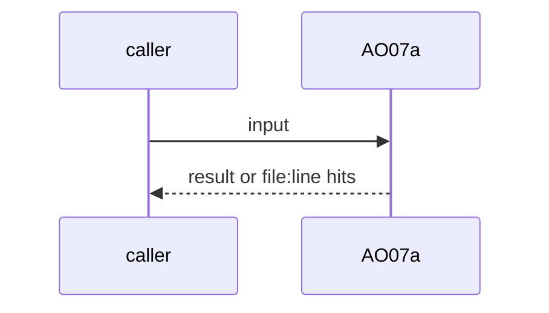
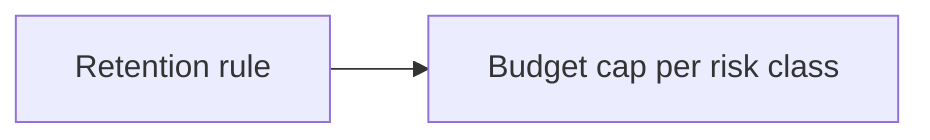

# AO07a: Trace retention for the scoring window and a scoring budget cap
- Status: todo
- Area: agent-ops
- Wave: W5
- Block: 5
- Lane: Builder
- Depends on: AO07, B01, POL26
- proof: retention rule keeps run audits for the scoring window; scoring stops at the budget cap per risk class (fixture)
- door: two-way
- triage: build
- feedback: cap fixture
- harness: none (script run by scripts/verify.sh)
- review-input: diff + this PBI + DoD (+ linked spec) + PR description, never builder session logs (PA6)
- kind: script
- Source: D6, D7 https://www.warp.dev/blog/using-llm-as-a-judge-scoring-to-measure-your-software-factory
## Goal
Keep run audits and artifacts for the scoring window only, and cap the scoring budget per risk class.
## Context
Warp judge blog: scoring needs traces with full input and output; scoring is "about 3% of total token costs"; sampling by percent or by class. PA3: 30 days proposal, never committed. Not built in PR #4: docs only, nothing enabled (PA9).
## Steps
1. Retention rule.
2. Budget cap per risk class.
## Definition of Done
- [ ] Retention documented
- [ ] Cap fixture stops scoring
## Technical design
- Components and files: AO07, `shared/risk-classes.md`
- Module boundary: window + cap
- Interfaces: config values
- Sequence:

- Failure modes: Cap reached: scoring skips, logs it
- Security: Redacted logs (POL26)
- Observability: spend per class
- Cost: cap value
- Rollback: Remove the cap
- Proof: same as proof: above
- Door: two-way (revert is one commit)
## Evidence
(todo)
## Flow

## Named asks for Sven
none
## Cost
cap value
## Sources
- [Warp blog, LLM-as-a-judge scoring](https://www.warp.dev/blog/using-llm-as-a-judge-scoring-to-measure-your-software-factory)
- Strategy id list v3.12 (aw-final-ids.md), url-learnings.md D6, D7
