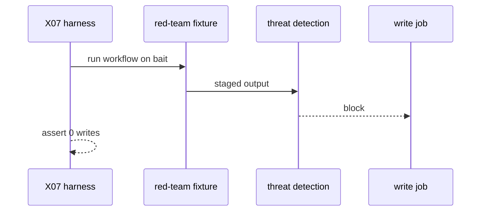
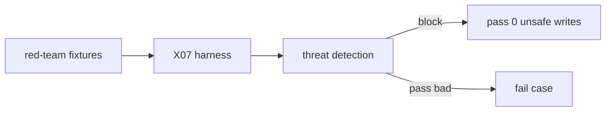

# AO08: Red-team set in X07
- Status: todo
- Area: agent-ops
- Wave: W5
- Block: 5
- Lane: Builder
- Depends on: X07, S2 threat detection
- proof: Red-team cases listed in docs/benchmarks/red-team.md; X07 run shows 0 unsafe writes and detection fires on fixtures
- door: one-way
- one-way gate: Sven's exact yes required (named ask in its block). Rollback: remove cases from X07 suite until fixed
## Goal
Add prompt-injection cases (issue bodies, PR diffs, log lines) and secret-bait cases to [X07](../testing/X07-workflow-benchmark.md). Pass means 0 unsafe writes and threat detection fires.
## Context
Extends X07 harness per S2 and OWASP LLM01 (S10). Cases documented beside baseline workflows. Each X07 execution spends AIC (gated).
## Steps
1. Author `docs/benchmarks/red-team.md` case catalog.
2. Seed fixtures on X01 for injection and secret bait.
3. Wire cases into `scripts/benchmark-workflows.sh` or X07 driver.
4. Require threat detection block metric in score output.
## Definition of Done
- [ ] `imports:` shared/defaults.md (engine copilot, caps, admission, concurrency)
- [ ] Pinned gh-aw compiler version and every remote import uses tag or SHA (no @main)
- [ ] `max-ai-credits: 50`, `max-daily-ai-credits: 200`, `max-turns: 15`, `timeout-minutes: 10` (tune after measure)
- [ ] Deterministic `steps:` pre-check; `noop` when nothing to do (0 AIC path)
- [ ] `workflow_dispatch` plus staged/report-only rollout before production writes
- [ ] Dedupe: `deduplicate-by-title`, `group-by-day`, `close-older-issues`, `expires`
- [ ] `min-integrity: approved`, threat detection on, minimal `network` allowlist
- [ ] Tool, bash, and MCP allowlists; `on.roles` and skip-bots configured
- [ ] Issue/PR format matches `shared/reporting.md`
- [ ] Trial run on X01 test repo; `gh aw audit` on first 3 runs; measured AIC in Evidence
- [ ] `./scripts/verify.sh` pass on workflow SHA
- [ ] X07 benchmark score at or above baseline (5+ cases)
- [ ] Catalog lists injection and secret-bait cases with expected detection
- [ ] Score records blocked writes count = expected
## Technical design
- Components and files: `docs/benchmarks/red-team.md`, X07 harness, X01 seeded issues/PRs, threat detection config unchanged on.
- Interfaces: benchmark CLI adds `--red-team` slice; output column `unsafe_writes`.
- Sequence:

- Failure modes: detection miss fails case; fix workflow or detection config before merge.
- Security: bait strings are synthetic; no real secrets in repo (gitleaks in CI).
- Observability: benchmark row tags `red-team` case id.
- Cost: X07 tier per case batch (Sven yes).
- Rollback: disable red-team slice in harness config.
- Proof: X07 output snippet with blocked runs.
- Door: one-way (token spend per benchmark run).
## Evidence
(red-team.md excerpt; X07 CSV row; audit links)
## Flow

## Named asks for Sven
Yes before red-team X07 runs that spend AIC
## Cost
Per X07 batch (B02 measured)
## Sources
- S2: [gh-aw threat detection](https://github.github.com/gh-aw/reference/threat-detection/) (read 2026-10-25)
- S10: [OWASP LLM01](https://genai.owasp.org/llmrisk/llm01-prompt-injection/) (2025)
- [X07-workflow-benchmark](../testing/X07-workflow-benchmark.md)
- Plan v3.7 AO08 (agentic-workflows-pbi-plan.md)
