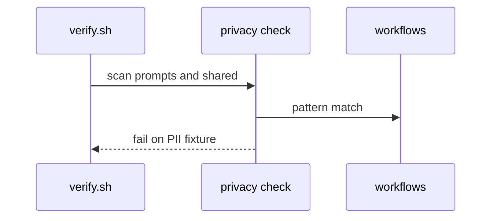
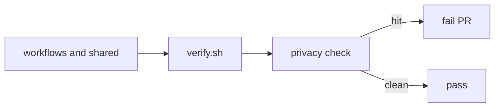

# AO09: Data + privacy rules
- Status: todo
- Area: agent-ops
- Wave: W5
- Block: 5
- Lane: Builder
- Depends on: C01, POL16
- proof: policies/checks or verify step flags sample PII string in workflow prompt fixture; docs/privacy/agent-data-rules.md merged
- door: two-way
## Goal
No personal data or customer names in prompts, outputs, or logs. Redaction check in C01 verify path. Postmortems follow S4 (roles, no customer detail).
## Context
Complements AO04 and AO10 labeling. NIST Map/Measure alignment (S11).
## Steps
1. Publish `docs/privacy/agent-data-rules.md` with examples of forbidden fields.
2. Add verify check or gitleaks-adjacent pattern for obvious PII placeholders in `workflows/` and `shared/`.
3. Link from shared/reporting.md footer guidance.
4. Train AO10 reviewers on label rubric.
## Definition of Done
- [ ] Rules doc lists forbidden data classes
- [ ] C01 or policy check fails on bad fixture
- [ ] AO04 postmortem template references this doc
- [ ] No real customer names in examples
## Technical design
- Components and files: `docs/privacy/agent-data-rules.md`, `policies/checks/AO09-privacy.sh` or extend C01, bad fixture under `test/fixtures/bad/`.
- Interfaces: verify.sh invokes check; exit 1 with file:line message.
- Sequence:

- Failure modes: over-broad regex; tune with good fixture pass.
- Security: rules reduce leak risk in issues and logs.
- Observability: check id in verify one-liner output.
- Cost: 0 AIC.
- Rollback: remove check from loop temporarily via PR (not recommended).
- Proof: bad fixture fails verify in CI log.
- Door: two-way (rules evolve in PR).
## Evidence
(verify failure line on bad fixture; rules doc link)
## Flow

## Named asks for Sven
Confirm any domain-specific fields to ban (internal ticket ids)
## Cost
0 AIC
## Sources
- S4: [Google Cloud blog: fearless shared postmortems](https://cloud.google.com/blog/products/gcp/fearless-shared-postmortems-cre-life-lessons) (read 2026-10-25)
- S11: [NIST AI 600-1](https://www.nist.gov/publications/artificial-intelligence-risk-management-framework-generative-artificial-intelligence) (July 2024)
