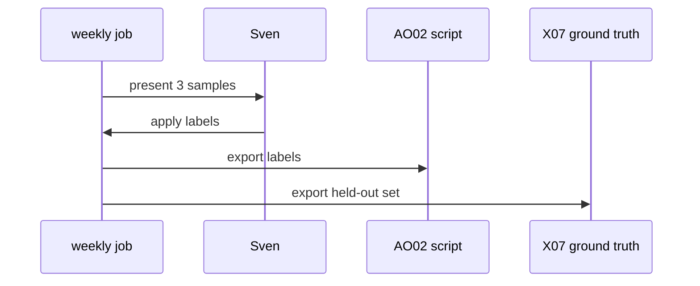
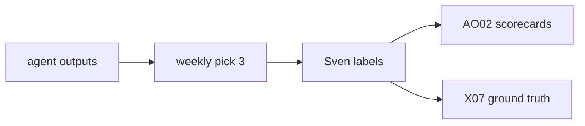

# AO10: Sampled human review
- Status: todo
- Area: agent-ops
- Wave: W5
- Block: 5
- Lane: Builder
- Depends on: AO02, X07
- proof: Weekly sample issue with three labeled outputs; labels feed AO02 fixture; link to folded F75 doc
- door: two-way
## Goal
Fixed weekly sample of agent output gets human labels: useful, noise, wrong. Feeds AO02 scorecards and X07 ground truth. **Absorbs [F75](../agent-factory/F75-weekly-merged-pr-sample.md)** (F75 is folded here; do not ship separate F75 workflow).
## Context
Stripe human review on agent PRs (S7). Shopify calibration input for judges (S9). gist 20 sampling cadence. Deterministic pick script can run 0 AIC; labeling is human.
## Steps
1. Weekly issue or discussion with 3 sampled agent outputs (rank risk and novelty).
2. Label set: `review:useful`, `review:noise`, `review:wrong`.
3. Export labels for AO02 script and AO13 calibration set.
4. Document overlap with former F75 scope in Sources.
## Definition of Done
- [ ] Weekly sample cadence documented
- [ ] Label taxonomy matches AO02 buckets
- [ ] X07 ground truth export path documented
- [ ] F75 fold noted with link to archived PBI
- [ ] No separate F75 workflow shipped
## Technical design
- Components and files: `workflows/ao10-sample-review.md` or script-only digest; label definitions in `docs/agent-ops/label-rubric.md`.
- Interfaces: GitHub labels on issues/comments; CSV export for AO13.
- Sequence:

- Failure modes: missed week; retro in AO01 notes gap.
- Security: samples scrubbed per AO09 before display.
- Observability: issue label `ao10-sample` with date.
- Cost: 0 AIC if script-only pick; optional small agent rank spends AIC (gated).
- Rollback: stop weekly schedule; keep labels.
- Proof: closed weekly issue with three labels.
- Door: two-way (process and schedule).
## Evidence
(sample issue URL; label export snippet)
## Flow

## Named asks for Sven
15 min weekly labeling until AO13 calibrated
## Cost
0-20 AIC if rank agent used (unverified)
## Sources
- gist 20 (sample review cadence, agent-ops.md)
- S7: [Stripe Minions part 1](https://stripe.dev/blog/minions-stripes-one-shot-end-to-end-coding-agents), [part 2](https://stripe.dev/blog/minions-stripes-one-shot-end-to-end-coding-agents-part-2) (2026-02-09, 2026-02-19)
- S9: [Shopify production-ready agentic systems](https://shopify.engineering/building-production-ready-agentic-systems), [Sidekick continual learning loop](https://shopify.engineering/sidekicks-continual-learning-loop) (2025, 2026)
- [F75-weekly-merged-pr-sample](../agent-factory/F75-weekly-merged-pr-sample.md) (folded)
