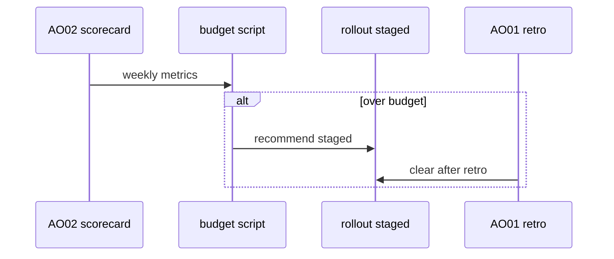
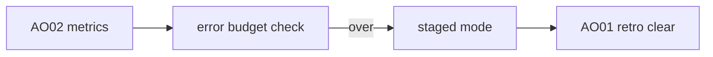

# AO11: Error budget per workflow
- Status: todo
- Area: agent-ops
- Wave: W5
- Block: 5
- Lane: Builder
- Depends on: AO02, AO01
- proof: docs/agent-ops/error-budget.md lists caps; staged mode flag documented when budget exhausted
- door: two-way
## Goal
Max false-alarm rate and max AIC per week per workflow. When either budget runs out, workflow drops to staged mode until AO01 retro clears it.
## Context
Google error budget policy (S6). Uses AO02 metrics. Works with per-workflow daily caps in frontmatter as backstop.
## Steps
1. Define budget numbers per workflow tier (after B02 measure).
2. Script compares AO02 weekly row to budget.
3. Set `staged: true` via PR or rollout.yml when over budget.
4. AO01 retro documents reset criteria.
## Definition of Done
- [ ] Budget metrics defined: false alarm rate, weekly AIC
- [ ] Staged mode transition documented
- [ ] Retro clears budget explicitly
- [ ] Links to Bar H cap fields in workflow frontmatter
## Technical design
- Components and files: `docs/agent-ops/error-budget.md`, `rollout.yml` staged flags, AO02 weekly markdown input.
- Interfaces: script exits 1 when over budget and opens issue; no auto merge.
- Sequence:

- Failure modes: false positive spike; human override via Sven PR to rollout.
- Security: staged mode prevents writes (gh-aw staged rollout).
- Observability: issue label `error-budget-exceeded`.
- Cost: 0 AIC for script.
- Rollback: revert staged flag in rollout.yml.
- Proof: tabletop with fixture over-budget row.
- Door: two-way (budget thresholds in PR).
## Evidence
(error-budget.md; sample exceeded issue)
## Flow

## Named asks for Sven
Approve initial budget numbers from B02 data
## Cost
0 AIC
## Sources
- S6: [SRE workbook: Error Budget Policy](https://sre.google/workbook/error-budget-policy/) (workbook, read 2026-10-25)
