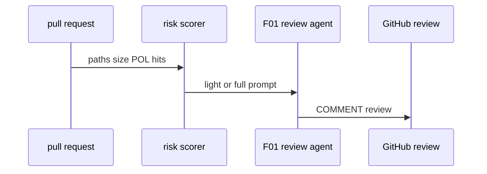
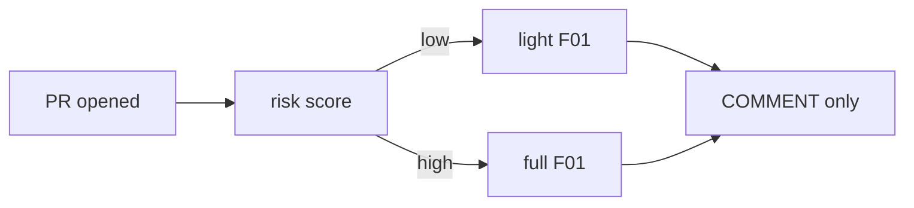

# AO12: Risk-based review routing
- Status: todo
- Area: agent-ops
- Wave: W5
- Block: 5
- Lane: Builder
- Depends on: F01, POL hits
- proof: gh aw compile --dir workflows --strict workflows/ao12-risk-route.md; F01 uses light vs full path on fixture PRs
- door: one-way
- one-way gate: Sven's exact yes required (named ask in its block). Rollback: disable routing workflow and default F01 to full review
## Goal
F01 reads change risk (paths, size, POL hits) and picks light or full review, saving AIC on low-risk PRs (S8 uReview style).
## Context
Integrates with existing F01 pr-review. High risk paths match ARC04 `shared/risk-classes.md` themes. Never APPROVE or merge (POL22, POL14).
## Steps
1. Extend F01 or add `ao12-risk-route.md` pre-step scoring PR diff.
2. Map score to light (short comment) vs full (deep) prompt branch.
3. Log branch taken in B01 for AO02.
4. Trial on X01 PR fixtures.
## Definition of Done
- [ ] `imports:` shared/defaults.md (engine copilot, caps, admission, concurrency)
- [ ] Pinned gh-aw compiler version and every remote import uses tag or SHA (no @main)
- [ ] `max-ai-credits: 50`, `max-daily-ai-credits: 200`, `max-turns: 15`, `timeout-minutes: 10` (tune after measure)
- [ ] Deterministic `steps:` pre-check; `noop` when nothing to do (0 AIC path)
- [ ] `workflow_dispatch` plus staged/report-only rollout before production writes
- [ ] Dedupe: `deduplicate-by-title`, `group-by-day`, `close-older-issues`, `expires`
- [ ] `min-integrity: approved`, threat detection on, minimal `network` allowlist
- [ ] Tool, bash, and MCP allowlists; `on.roles` and skip-bots configured
- [ ] Issue/PR format matches `shared/reporting.md`
- [ ] Trial run on X01 test repo; `gh aw audit` on first 3 runs; measured AIC in Evidence
- [ ] `./scripts/verify.sh` pass on workflow SHA
- [ ] X07 benchmark score at or above baseline (5+ cases)
- [ ] Light vs full routing documented with path rules
- [ ] POL22 COMMENT only on reviews
## Technical design
- Components and files: `workflows/ao12-risk-route.md` or F01 branch; risk table shared with M05 classes.
- Interfaces: GitHub PR files API; output review COMMENT via safe-output.
- Sequence:

- Failure modes: scorer wrong; human overrule tracked in AO02.
- Security: read-only agent; no write except review comment max.
- Observability: log `review-depth: light|full`.
- Cost: lower AIC on light path (measure in Evidence).
- Rollback: disable routing; full review only.
- Proof: audit three runs with depth logged.
- Door: one-way (token spend and promotion).
## Evidence
(AIC compare light vs full; verify log)
## Flow

## Named asks for Sven
Yes to enable event trigger on F01 after 3 audited manual runs
## Cost
Tier M, variable savings (unverified)
## Sources
- S8: [Uber blog: uReview](https://www.uber.com/us/en/blog/ureview/), [AI Engineer talk](https://www.youtube.com/watch?v=EL123UNokkI) (read 2026-10-25)
- Plan v3.7 AO12 (agentic-workflows-pbi-plan.md)
