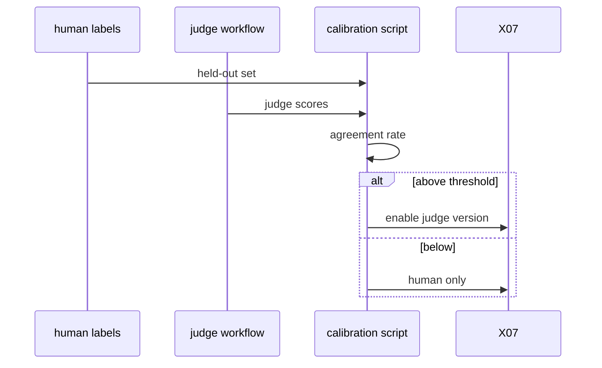
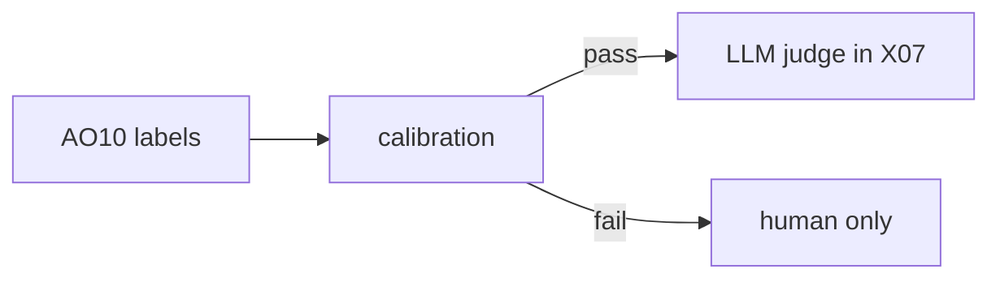

# AO13: Calibrated judge for X07
- Status: todo
- Area: agent-ops
- Wave: W5
- Block: 5
- Lane: Builder
- Depends on: AO10, X07
- proof: Calibration report agrees with AO10 held-out labels above threshold; judge disabled when below threshold
- door: one-way
- one-way gate: Sven's exact yes required (named ask in its block). Rollback: X07 uses human labels only until recalibrated
## Goal
When a benchmark case needs judgment, an LLM judge scores it only after it agrees with AO10 human labels on a held-out set (S9).
## Context
Feeds X07 ambiguous cases. Shopify calibration pattern. Judge spends AIC; gated per run.
## Steps
1. Export held-out set from AO10 labels.
2. Run calibration job comparing judge vs human.
3. Document agreement threshold (e.g. 90%) before enabling judge in X07.
4. Store calibration version in `docs/benchmarks/judge-calibration.md`.
## Definition of Done
- [ ] `imports:` shared/defaults.md (engine copilot, caps, admission, concurrency)
- [ ] Pinned gh-aw compiler version and every remote import uses tag or SHA (no @main)
- [ ] `max-ai-credits: 50`, `max-daily-ai-credits: 200`, `max-turns: 15`, `timeout-minutes: 10` (tune after measure)
- [ ] Deterministic `steps:` pre-check; `noop` when nothing to do (0 AIC path)
- [ ] `workflow_dispatch` plus staged/report-only rollout before production writes
- [ ] Dedupe: `deduplicate-by-title`, `group-by-day`, `close-older-issues`, `expires`
- [ ] `min-integrity: approved`, threat detection on, minimal `network` allowlist
- [ ] Tool, bash, and MCP allowlists; `on.roles` and skip-bots configured
- [ ] Issue/PR format matches `shared/reporting.md`
- [ ] Trial run on X01 test repo; `gh aw audit` on first 3 runs; measured AIC in Evidence
- [ ] `./scripts/verify.sh` pass on workflow SHA
- [ ] X07 benchmark score at or above baseline (5+ cases)
- [ ] Calibration report meets threshold on held-out AO10 labels
- [ ] Judge version pinned in benchmark docs
## Technical design
- Components and files: `workflows/ao13-calibrate-judge.md`, `docs/benchmarks/judge-calibration.md`, AO10 export CSV.
- Interfaces: judge prompt version; agreement metrics script; X07 hook calls judge only if calibration current.
- Sequence:

- Failure modes: drift when model changes; recalibrate on prompt bump (AO05).
- Security: judge read-only on fixtures; no writes.
- Observability: calibration markdown committed each run.
- Cost: calibration batch AIC (Sven yes).
- Rollback: pin judge off in X07 config.
- Proof: calibration file with date and agreement rate.
- Door: one-way (judge runs spend tokens).
## Evidence
(judge-calibration.md; audit run ids)
## Flow

## Named asks for Sven
Yes per calibration batch spend; approve threshold number
## Cost
Tier M per calibration (unverified)
## Sources
- S9: [Shopify: production-ready agentic systems](https://shopify.engineering/building-production-ready-agentic-systems), [Sidekick continual learning loop](https://shopify.engineering/sidekicks-continual-learning-loop) (2025, 2026)
- [X07-workflow-benchmark](../testing/X07-workflow-benchmark.md)
- Plan v3.7 AO13 (agentic-workflows-pbi-plan.md)
