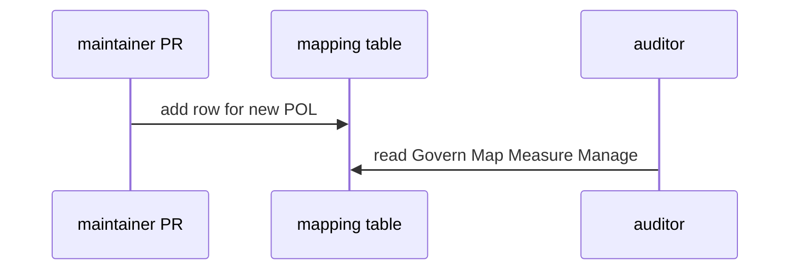
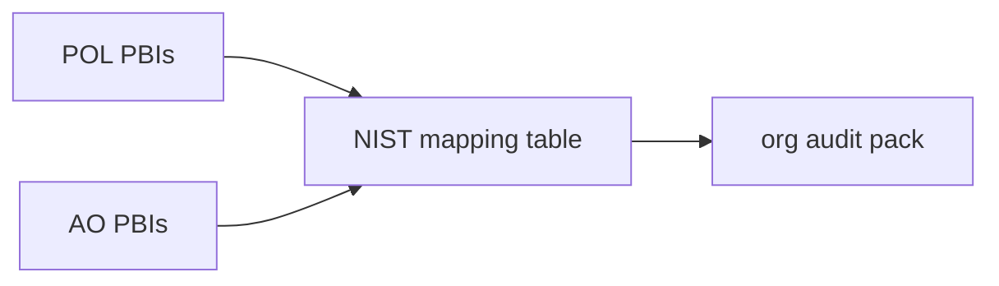

# AO14: NIST mapping doc
- Status: todo
- Area: agent-ops
- Wave: W5
- Block: 5
- Lane: Builder
- Depends on: POL01-POL23, AO01-AO13
- proof: docs/compliance/nist-ai-rmf-mapping.md merged; every POL and AO row has Govern Map Measure or Manage column filled
- door: two-way
## Goal
Map each POL and AO PBI to NIST AI RMF functions: Govern, Map, Measure, or Manage, for org-ready audits (S11).
## Context
Static doc updated when POL or AO PBIs change. No agent workflow required. Supports G05 org switch narrative.
## Steps
1. Create `docs/compliance/nist-ai-rmf-mapping.md` table.
2. Row per POL01-POL23 and AO01-AO14 with primary function and notes.
3. Link to source NIST AI 600-1 sections where helpful.
4. Reviewer checks mapping on any new POL or AO PR.
## Definition of Done
- [ ] All POL ids listed
- [ ] All AO ids listed
- [ ] Each row has Govern, Map, Measure, or Manage
- [ ] Links to AO and POL markdown PBIs resolve
## Technical design
- Components and files: `docs/compliance/nist-ai-rmf-mapping.md`, index link from agent-ops overview.
- Interfaces: none; markdown table for auditors.
- Sequence:

- Failure modes: stale row; POL addition requires mapping update in same PR.
- Security: no secrets in compliance doc.
- Observability: git history shows mapping changes.
- Cost: 0 AIC.
- Rollback: revert mapping PR.
- Proof: file exists; spot-check 5 rows against NIST doc.
- Door: two-way (mapping evolves with catalog).
## Evidence
(mapping PR link; reviewer sign-off in PR description)
## Flow

## Named asks for Sven
Optional external audit date (calendar)
## Cost
0 AIC
## Sources
- S11: [NIST AI 600-1](https://www.nist.gov/publications/artificial-intelligence-risk-management-framework-generative-artificial-intelligence) (July 2024)
- Plan v3.7 agent-ops pack (agentic-workflows-pbi-plan.md)
