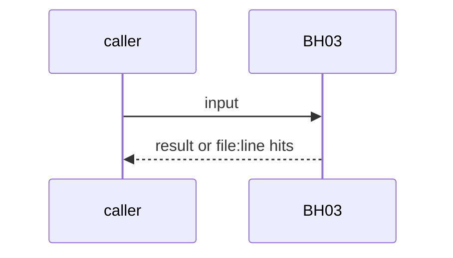
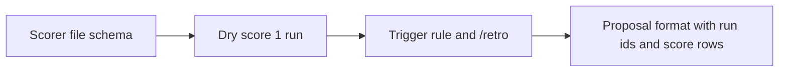

# BH03: Run scoring: scorer file, dry score, failure trigger
- Status: todo
- Area: agent-ops
- Wave: W3
- Block: 3 doc, run 5
- Lane: Builder
- Depends on: AO01, AO07a, LP00
- proof: scorer file schema check; dry score of 1 run; proposal fixture lists run ids and score rows
- door: one-way
- one-way gate: spend: manual first, 3 audited runs with measured cost, then Sven's exact yes before any schedule (PA1). Rollback: delete the scorer file, scoring stops
- triage: spec (doc in B3, run in B5)
- feedback: schema check on `scorers/<name>.md` plus the dry-score run
- harness: gh-aw, engine copilot via shared/defaults.md (when built)
- review-input: diff + this PBI + DoD (+ linked spec) + PR description, never builder session logs (PA6)
- kind: script
- Source: D1, D2, D3, D4, D5, D8, PA1 https://docs.warp.dev/factories/measure-and-improve/scorers/ https://www.warp.dev/blog/using-llm-as-a-judge-scoring-to-measure-your-software-factory https://docs.warp.dev/factories/measure-and-improve/self-improvement/ https://x.com/BHolmesDev/status/2102514161892651286 https://github.com/svennijhuis/agentic-workflows/pull/4
## Goal
Score past runs with one scorer file per question: question, labels mapped to a score, pass threshold, sample rate, recorded reasoning. Dry-score 1 run before raising the sample rate. Trigger on N distinct failures or the oldest failure 7 days old, or `/retro`. The proposal lists run ids and score rows; the improver gets the run log and the score report. Manual first, 3 audited runs, Sven's yes.
## Context
Warp Scorers: a scorer "assigns a classification, not a numeric grade", fields are agents, judge instructions, judge model, classifications each with a score, pass threshold, sample rate; one run can be scored on demand to test judge instructions. Self-improvement doc: a run starts after 25 distinct unreviewed failures or when the oldest is seven days old; each PR has a Regressions addressed section. Ben Holmes: the improver gets the raw transcript and the scorer report. Start set: efficiency and task compliance, static proxies first. Not built in PR #4: docs only, nothing enabled (PA9).
## Steps
1. Scorer file schema.
2. Dry score 1 run.
3. Trigger rule and `/retro`.
4. Proposal format with run ids and score rows.
## Definition of Done
- [ ] Schema check red on a scorer without threshold
- [ ] Dry score recorded
- [ ] Proposal fixture lists run ids
- [ ] 3 audited runs and cost before Sven's yes
- [ ] Every Bar H line from [README.md](../README.md#bar-h-every-workflow-pbi) when the workflow ships
## Technical design
- Components and files: `scorers/`, AO01, LP00
- Module boundary: one scorer file per question
- Interfaces: scorer fields; `/retro`
- Sequence:

- Failure modes: Unclear label set: scorer rejected by the schema
- Security: Run logs redacted, never committed
- Observability: score rows per run
- Cost: judge tokens per sampled run, cap from AO07a
- Rollback: Delete the scorer file
- Proof: same as proof: above
- Door: one-way (spend or autonomy, Sven's yes)
## Evidence
(todo)
## Flow

## Named asks for Sven
Sven's exact yes before the one-way step: spend: manual first, 3 audited runs with measured cost, then Sven's exact yes before any schedule (PA1)
## Cost
judge tokens per sampled run, cap from AO07a
## Sources
- [Warp Scorers doc](https://docs.warp.dev/factories/measure-and-improve/scorers/)
- [Warp blog, LLM-as-a-judge scoring](https://www.warp.dev/blog/using-llm-as-a-judge-scoring-to-measure-your-software-factory)
- [Warp Self-improvement doc](https://docs.warp.dev/factories/measure-and-improve/self-improvement/)
- [Ben Holmes, scorer and self-improvement agents](https://x.com/BHolmesDev/status/2102514161892651286)
- [agentic-workflows PR #4 room (PO additions PA1 to PA9)](https://github.com/svennijhuis/agentic-workflows/pull/4)
- Strategy id list v3.12 (aw-final-ids.md), url-learnings.md D1, D2, D3, D4, D5, D8, PA1
