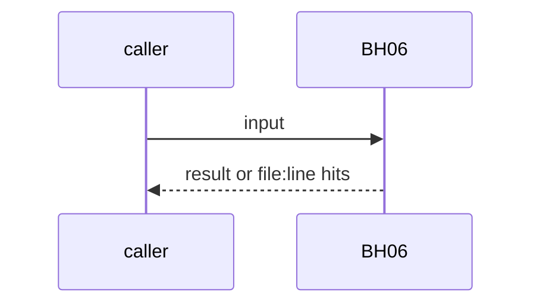
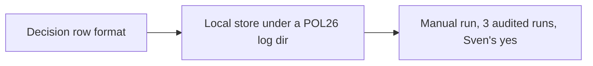

# BH06: Override harvest: decision and reason only
- Status: todo
- Area: agent-ops
- Wave: W5
- Block: 5
- Lane: Builder
- Depends on: LP00, AO09, POL26
- proof: fixture: a relabel by Sven becomes one decision row (label before, after, short reason), no thread text, no personal data; store is local, redacted, 30 days, never committed (POL26)
- door: one-way
- one-way gate: manual only until Sven's exact yes on a schedule (PA1). Rollback: stop the harvest, delete the local store
- triage: spec
- feedback: harvest fixture plus POL26
- harness: gh-aw, engine copilot via shared/defaults.md (when built)
- review-input: diff + this PBI + DoD (+ linked spec) + PR description, never builder session logs (PA6)
- kind: script
- Source: D9, PA1, PA2, PA3 https://www.warp.dev/blog/self-improvement-loop-for-skills https://www.warp.dev/blog/how-to-build-a-cloud-software-factory-self-improving-code-review https://github.com/svennijhuis/agentic-workflows/pull/4
## Goal
When Sven overrides agent output (relabels F72 or F06 output, marks an F01 comment wrong), record only the decision and a short reason. These rows feed a skill-diff proposal PR that a human merges.
## Context
Warp skills loop: a reviewer changes a label and comments why, and a daily outer agent turns the change and reason into a skill diff. Warp review: the outer loop synthesizes human feedback on review comments. PA2: only the decision, never full threads or personal data. PA3: local, redacted, 30 days, never committed. Not built in PR #4: docs only, nothing enabled (PA9).
## Steps
1. Decision row format.
2. Local store under a POL26 log dir.
3. Manual run, 3 audited runs, Sven's yes.
## Definition of Done
- [ ] Fixture row has no thread text
- [ ] Store ignored and scanned by POL26
- [ ] Manual only
- [ ] Every Bar H line from [README.md](../README.md#bar-h-every-workflow-pbi) when the workflow ships
## Technical design
- Components and files: LP00, AO09, local store
- Module boundary: decision row
- Interfaces: row fields
- Sequence:

- Failure modes: Missing reason: row kept, flagged
- Security: Redaction checked by AO09 and gitleaks
- Observability: row count per week
- Cost: per run, measured
- Rollback: Stop, delete the store
- Proof: same as proof: above
- Door: one-way (spend or autonomy, Sven's yes)
## Evidence
(todo)
## Flow

## Named asks for Sven
Sven's exact yes before the one-way step: manual only until Sven's exact yes on a schedule (PA1)
## Cost
per run, measured
## Sources
- [Warp blog, self-improvement loop for skills](https://www.warp.dev/blog/self-improvement-loop-for-skills)
- [Warp blog, self-improving code review](https://www.warp.dev/blog/how-to-build-a-cloud-software-factory-self-improving-code-review)
- [agentic-workflows PR #4 room (PO additions PA1 to PA9)](https://github.com/svennijhuis/agentic-workflows/pull/4)
- Strategy id list v3.12 (aw-final-ids.md), url-learnings.md D9, PA1, PA2, PA3
