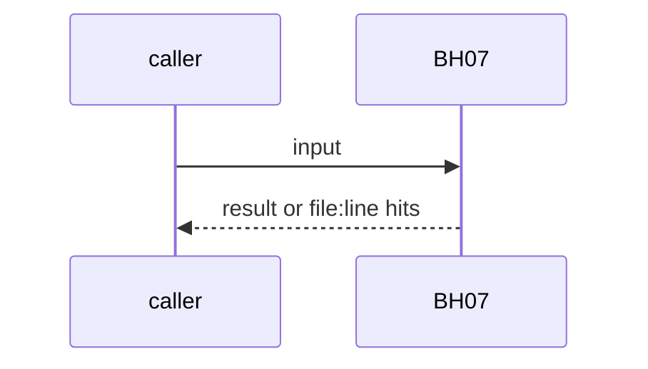
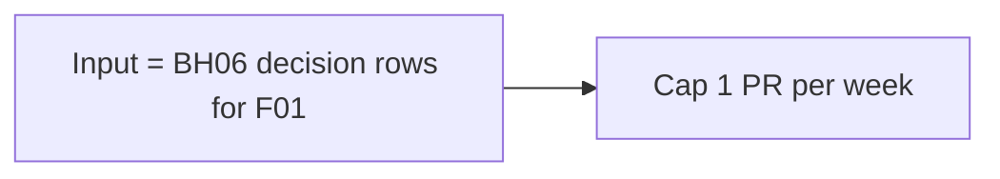

# BH07: F01 learns from Sven's replies
- Status: todo
- Area: agent-ops
- Wave: W5
- Block: 5
- Lane: Builder
- Depends on: F01, BH06, LP00
- proof: fixture: Sven's replies on F01 comments produce at most 1 prompt-diff PR per week; the PR is never merged by an agent
- door: one-way
- one-way gate: manual first, 3 audited runs, Sven's exact yes before a schedule (PA1). Rollback: close the proposal PR, the skill stays
- triage: spec
- feedback: weekly cap fixture
- harness: gh-aw, engine copilot via shared/defaults.md (when built)
- review-input: diff + this PBI + DoD (+ linked spec) + PR description, never builder session logs (PA6)
- kind: skill
- Source: D20 https://www.warp.dev/blog/how-to-build-a-cloud-software-factory-self-improving-code-review
## Goal
Read Sven's replies on F01 comments and propose an F01 prompt diff, at most 1 PR per week. A human merges.
## Context
Warp review post: a daily agent reads reviewed PRs, synthesizes human feedback on review comments, and opens a PR updating the review skill. Not built in PR #4: docs only, nothing enabled (PA9).
## Steps
1. Input = BH06 decision rows for F01.
2. Cap 1 PR per week.
## Definition of Done
- [ ] Cap fixture
- [ ] No agent merge (human merges only)
- [ ] Every Bar H line from [README.md](../README.md#bar-h-every-workflow-pbi) when the workflow ships
## Technical design
- Components and files: LP00 step, F01 prompt
- Module boundary: one proposal PR
- Interfaces: PR body cites run ids (BH03)
- Sequence:

- Failure modes: Nothing to learn: noop
- Security: Read-only on comments
- Observability: PR count
- Cost: per run, measured
- Rollback: Close the PR
- Proof: same as proof: above
- Door: one-way (spend or autonomy, Sven's yes)
## Evidence
(todo)
## Flow

## Named asks for Sven
Sven's exact yes before the one-way step: manual first, 3 audited runs, Sven's exact yes before a schedule (PA1)
## Cost
per run, measured
## Sources
- [Warp blog, self-improving code review](https://www.warp.dev/blog/how-to-build-a-cloud-software-factory-self-improving-code-review)
- Strategy id list v3.12 (aw-final-ids.md), url-learnings.md D20
