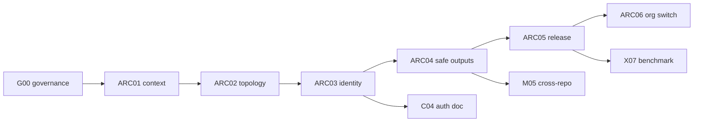

# architecture: overview

**Purpose:** G00 org-ready architecture: six linked pages (ARC01-ARC06) that describe containers, repo topology, identity, safe outputs, release, and the org switch. They are the expanded G00 anchor for consumers, C04 auth, and LP02 guards. Facts on gh-aw security layers come from the [GitHub security architecture blog](https://github.blog/ai-and-ml/generative-ai/under-the-hood-security-architecture-of-github-agentic-workflows/) and [safe outputs reference](https://github.github.com/gh-aw/reference/safe-outputs/) (read 2026-10-25).

## PBIs

- [ARC01: Context and containers](ARC01-context.md)
- [ARC02: Repo topology](ARC02-repo-topology.md)
- [ARC03: Identity and auth](ARC03-identity-auth.md)
- [ARC04: Safe output flow](ARC04-safe-output-flow.md)
- [ARC05: Release flow](ARC05-release-flow.md)
- [ARC06: Org switch](ARC06-org-switch.md)

Related governance: [G00-org-target-structure](../governance/G00-org-target-structure.md), [G05-org-only-appendix](../governance/G05-org-only-appendix.md).

## Dependency sketch

