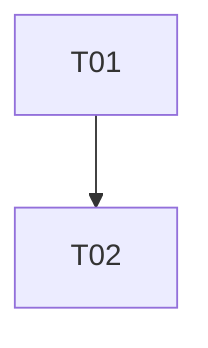

# copilot-teams: overview

**Purpose:** Microsoft Teams integration feasibility and use cases.

## PBIs

- [T01: T01-teams-setup-feasibility](T01-teams-setup-feasibility.md)
- [T02: T02-teams-use-cases](T02-teams-use-cases.md)

## Dependency sketch

