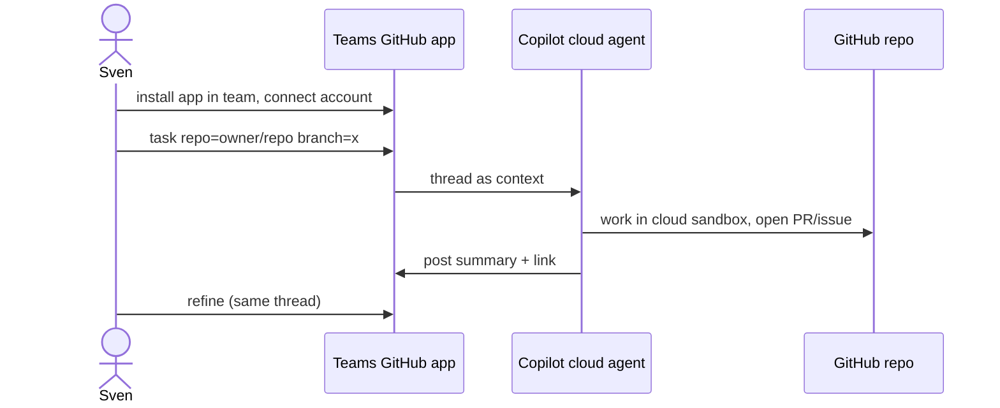

# T01: Microsoft Teams setup and feasibility
- Status: todo
- Area: docs
- Wave: PR 0
- Block: 5
- Lane: Cursor CLI
- Depends on: D00
- proof: test -f docs/pbi/copilot-teams/T01-teams-setup-feasibility.md
- door: two-way
## Goal
Document whether Copilot cloud agent in Teams is viable for Sven's tenant and personal GitHub account.
## Context
Public preview; needs Teams app install, account connect, and tenant policy. Personal GitHub works; Teams admin may block third-party apps (Q8).
## Steps
1. Write feasibility checklist (tenant admin, app install, cloud sandboxes).
2. Map flow (d) to our repos and approval rules.
3. List blockers vs M365 personal vs work tenant.
## Definition of Done
- [ ] Feasibility doc section in Diataxis explanation path
- [ ] Flow (d) included
- [ ] No secrets or tenant ids in repo
## Evidence
(links to published Diataxis paths, review notes)
## Flow

## Named asks for Sven
Q8 (Teams tenant + admin)
## Cost
n/a (documentation)
## Sources
- https://docs.github.com/en/copilot/how-tos/copilot-integrations/integrate-cloud-agent-with-teams
- Research packet flow (d): Copilot cloud agent in Teams (Strategy gh-aw-org-packet)
