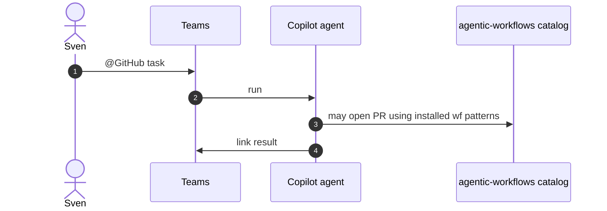

# T02: Teams use cases for agentic workflows
- Status: todo
- Area: docs
- Wave: W5
- Block: 5
- Lane: Cursor CLI
- Depends on: T01, D02, P04
- proof: test -f docs/pbi/copilot-teams/T02-teams-use-cases.md
- door: two-way
## Goal
Define 2-3 concrete Teams scenarios (status ask, small fix, research handoff) aligned with catalog workflows.
## Context
Teams is not a gh-aw engine host; it triggers Copilot cloud agent. Keep boundaries clear vs in-repo `workflow_dispatch`.
## Steps
1. Scenario table: trigger, repo, expected artifact, cost tier.
2. Link to P04 research-plan-assign where overlap exists.
3. Rollout: human-in-loop only.
## Definition of Done
- [ ] Each use case names target repo and risk level
- [ ] Cross-links to F workflows where relevant
## Evidence
(links to published Diataxis paths, review notes)
## Flow

## Named asks for Sven
Q8
## Cost
n/a
## Sources
- https://docs.github.com/en/copilot/how-tos/copilot-integrations/integrate-cloud-agent-with-teams
- https://github.github.com/gh-aw/patterns/chat-ops/
