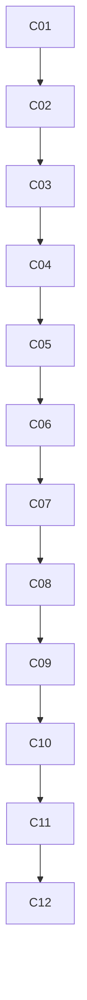

# core: overview

**Purpose:** Catalog foundation: layout, verify script, imports, auth, engine, agentPacks contract.

## PBIs

- [C01: C01-verify-script](../done/C01-verify-script.md)
- [C02: C02-org-ready-layout](../done/C02-org-ready-layout.md)
- [C03: C03-shared-defaults](../done/C03-shared-defaults.md)
- [C04: C04-auth-copilot-pat](../done/C04-auth-copilot-pat.md)
- [C05: C05-imports-import-schema](../done/C05-imports-import-schema.md)
- [C06: C06-copilot-engine-version-pins](../done/C06-copilot-engine-version-pins.md)
- [C07: C07-engine-portability-matrix](C07-engine-portability-matrix.md)
- [C08: C08-runtime-profiles](C08-runtime-profiles.md)
- [C09: C09-self-hosted-arc-runners](C09-self-hosted-arc-runners.md)
- [C10: C10-copilot-byok-azure-openai](C10-copilot-byok-azure-openai.md)
- [C11: C11-instructions-copilot-agents-md](../done/C11-instructions-copilot-agents-md.md)
- [C12: C12-agentpacks-import-contract](../done/C12-agentpacks-import-contract.md)

## Dependency sketch

