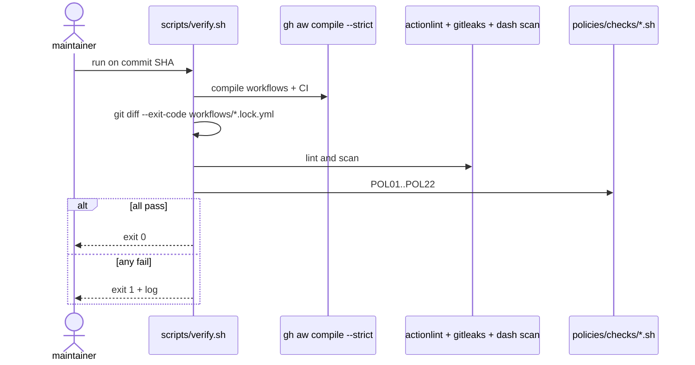

# C01: Verify script (`scripts/verify.sh`)
- Status: todo
- Area: core
- Wave: W1
- Block: 1
- Lane: Builder
- Depends on: none
- proof: ./scripts/verify.sh (exit 0 on green SHA; last line `0 failures` on pass)
- door: two-way
## Goal
Ship one verify script (`scripts/verify.sh`) that local developers and CI both run. It blocks bad workflow and policy changes before merge. Until GitHub Actions billing is fixed (Q0), a green run on the exact commit SHA is the release authority instead of CI.
## Context
Plan W1 starts with [X06](../testing/X06-verification-skill.md) (verification skill spec) then C01 plus POL01 through POL23 checks and fixtures. Gist handover points A, B, and C define the minimum bar: compile strict, lock drift, linters, secret and style scans, and every `policies/checks/*.sh`. Personal account `svennijhuis` only; org rulesets may mirror POL19 later (G05).
## Steps
1. Add `scripts/verify.sh` with a stable interface: `./scripts/verify.sh` from repo root, non-zero exit on any failure.
2. Compile: `gh aw compile --dir workflows --strict` for catalog workflows; compile repo CI under `.github/workflows/` with the same strictness.
3. Lock drift: after compile, `git diff --exit-code workflows/*.lock.yml` (and CI lock paths if applicable). POL17 requires committed fresh locks.
4. Linters: `actionlint` on compiled YAML; optional zizmor where adopted.
5. Style: reject U+2013 and U+2014 in tracked markdown and workflow sources (POL16).
6. Secrets: `gitleaks` on tracked files (POL04); POL20 secret-pattern scan on markdown where specified.
7. Invoke each `policies/checks/POL*.sh` including POL01 pins (imports and `plugins:`), POL02 caps in each workflow frontmatter, POL21 `copilot-requests: none`, POL22 review COMMENT only, POL19 no force push in automation, and [POL23](../policies/POL23-no-tautological-checks.md) good/bad pairing for every check.
8. Output contract (gist A3): on failure, print one line per failure as `file:line rule-id message`; on pass print no failure lines; always end with a last line `N failures` where N is the failure count; exit code 0 only when N is 0.
9. Pin CI helpers per gist C: `actions/checkout` by full SHA (not a floating tag) and `gh-aw` extension `v0.93.4`. Point `.github/workflows/*` at `scripts/verify.sh` instead of ad hoc compile steps.
10. Document Q0 in CONTRIBUTING (Builder): when Actions billing is blocked, attach verify log on SHA in PR evidence.
## Definition of Done
- [ ] `scripts/verify.sh` exists and runs compile strict, lock drift, actionlint, em dash scan, gitleaks, and all policy checks POL01 through POL23
- [ ] Failure output is one line per failure: `file:line rule-id message`; on pass no failure lines; last line `N failures`; exit 0 only when N is 0
- [ ] Verify passes on green SHA with `test/fixtures/good/` coverage
- [ ] Verify fails on each `test/fixtures/bad/POL*.md` (one bad fixture per policy)
- [ ] CI workflow calls the same script as local (when Q0 unblocks Actions billing)
- [ ] Evidence: verify log attached for at least one green SHA on `builder/pbi-docs`
## Evidence
(commands, logs, verify log on SHA, run links)
## Flow

## Named asks for Sven
Q0 (GitHub Actions billing blocked; local `scripts/verify.sh` on SHA until fixed)
## Cost
n/a
## Sources
- https://github.github.com/gh-aw/guides/sharing-workflows/
- https://github.com/svennijhuis/agentic-workflows/pull/2
- Gist handover points A, B, C (`gist-handover-agentic-workflows.md` in workspace, plain text only)
- Plan v3.2 C01 verify.sh
