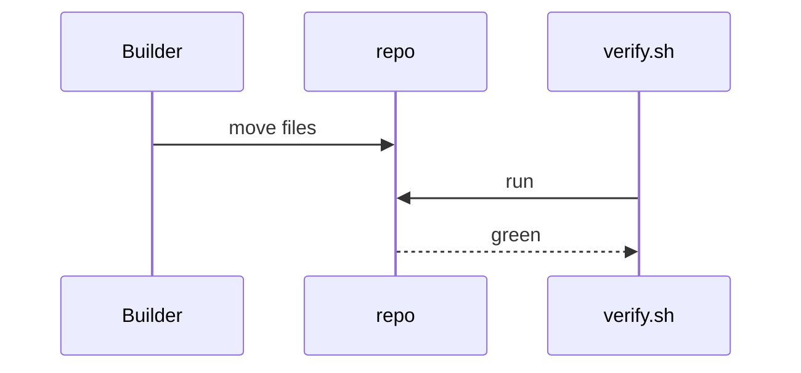
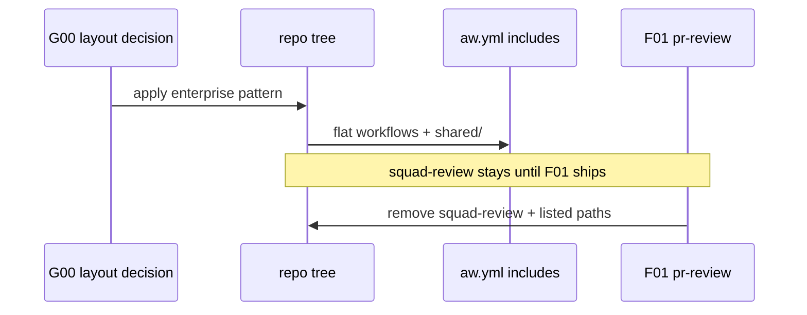

# C02: Org-ready repository layout
- Status: todo
- Area: core
- Wave: W1
- Block: 1
- Lane: Builder
- Depends on: G00, C01
- proof: ./scripts/verify.sh && test -f aw.yml
- door: two-way
## Goal
Restructure the repo to the gh-aw Recommended Enterprise Pattern: root `workflows/`, `shared/`, `policies/`, `scripts/verify.sh`, Diataxis `docs/`, and `governance/`. Owner is one variable (`svennijhuis` today). Keep `workflows/squad-review.md` until F01 merges; document every file removed when squad-review is deleted.
## Context
Decision 0001 picks agentics-style flat `workflows/` plus `aw.yml` manifest. Org-only switches (central billing, rulesets, org secrets, teams) stay documented in G05, not enabled on the personal account.
## Steps
1. Align tree with plan v3: `aw.yml`, `.github/aw.json`, `workflows/*.md`, `shared/` (defaults, security, outputs, reporting, policies, mcp, prompts), `policies/<id>.yml` + `policies/checks/`, `scripts/verify.sh`, `test/fixtures/`, `.github/copilot-instructions.md`, `AGENTS.md`, `.github/instructions/`, `.github/agents/aw-author.agent.md`, `governance/*`.
2. Move `workflows/shared/*` into top-level `shared/` per target layout (list each move in PR).
3. Keep squad-review in `includes:` until F01; add removal PBI checklist of files deleted.
4. Ensure install path stays `gh aw add svennijhuis/agentic-workflows/<name>@<ver>` with flat workflow names.
## Definition of Done
- [ ] Directory layout matches plan v3 and decision 0001
- [ ] `aw.yml` `includes:` lists only installable workflows; squad-review remains until F01
- [ ] Removal list drafted for post-F01 squad-review deletion (every path named)
- [ ] Gate (C01) passes on layout migration SHA
- [ ] No org-only features enabled; owner variable documented for future org switch
## Technical design
- Components and files: Layout from the plan Repo structure: `aw.yml`, `workflows/`, `shared/`, `policies/`, `test/`, `docs/`, `governance/`. Keeps squad-review until F01
- Interfaces: `aw.yml` package manifest, `.github/aw.json` compiler config
- Sequence:

- Failure modes: Moved paths break `gh aw add` paths, so `workflows/` stays flat
- Security: CODEOWNERS on `workflows/`, `shared/`, `policies/`
- Observability: `tree -L 2` output in the PR
- Cost: 0 AIC (files)
- Rollback: Revert the PR
- Proof: `tree -L 2` in the PR plus verify.sh green
- Door: two-way (file moves)
## Evidence
(commands, logs, verify log on SHA, run links)
## Flow

## Named asks for Sven
none
## Cost
n/a
## Sources
- https://github.github.com/gh-aw/guides/sharing-workflows/
- https://github.github.com/gh-aw/reference/auth/
- https://github.github.com/gh-aw/reference/cost-management/
- https://github.github.com/gh-aw/reference/imports/
- https://github.github.com/gh-aw/reference/engines/copilot/
- https://github.github.com/svennijhuis/agentic-workflows
