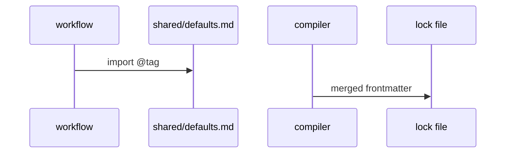
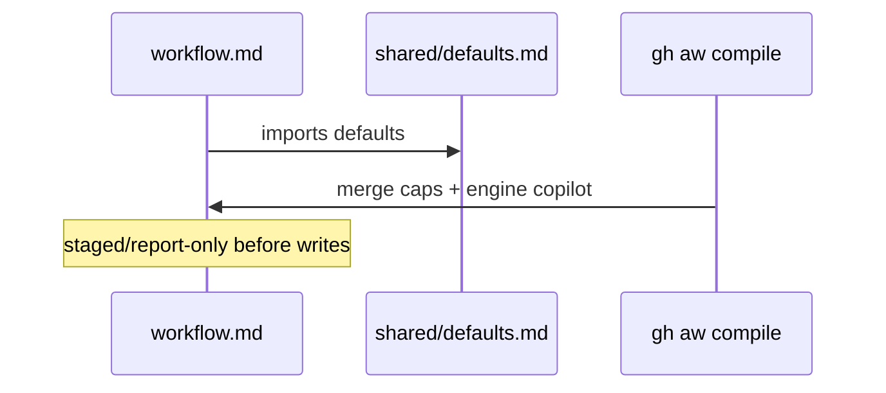

# C03: shared/defaults: Copilot engine, caps, admission
- Status: todo
- Area: core
- Wave: W1
- Block: 1
- Lane: Builder
- Depends on: C02, C05
- proof: gh aw compile --dir workflows --strict && ./scripts/verify.sh
- door: two-way
## Goal
Provide `shared/defaults.md` imported by every workflow: `engine: copilot`, pinned gh-aw import tag or SHA, model routing and aliases, fallback models, cost caps (50 AIC per run, 200 per day starting suggestion), admission rules, concurrency, timeouts, and sub-agent limits.
## Context
Personal account uses `COPILOT_GITHUB_TOKEN` fine-grained PAT; `copilot-requests` org billing is not used. Defaults must be far below gh-aw platform defaults (1000/run, 5000/day) to protect Copilot Pro monthly credits. Model and prompt comparisons use the [X07](../testing/X07-workflow-benchmark.md) score per AIC on the same fixed case set.
## Steps
1. Author `shared/defaults.md` as a shared component (no `on:`).
2. Set `engine: copilot` and document model aliases per gh-aw Copilot reference.
3. Set `max-ai-credits: 50`, `max-daily-ai-credits: 200`, `max-turns`, `timeout-minutes` (starting suggestion, unverified).
4. Add admission, concurrency, and sub-agent guardrails consistent with POL02, POL09, POL15.
5. Require every workflow PBI to import shared defaults (Bar H).
## Definition of Done
- [ ] `shared/defaults.md` exists and validates as shared import
- [ ] Every NOW workflow imports shared defaults
- [ ] Cost caps present and match POL02
- [ ] Engine is copilot everywhere in catalog
- [ ] First three runs per workflow record measured AIC in owning PBI (Bar H audit)
- [ ] Model or prompt comparison docs reference X07 score per AIC on the shared benchmark cases
## Technical design
- Components and files: `shared/defaults.md`
- Interfaces: Engine copilot pinned, model routing + aliases (incl `small`), fallback-models, concurrency, sub-agents. Caps NOT here (POL02, compiler ignores them in imports)
- Sequence:

- Failure modes: A default change hits all consumers, so release flow ARC05 plus an X07 score run first
- Security: No secrets in shared files
- Observability: Lock diff shows the merged frontmatter; X07 score per model per AIC
- Cost: 0 AIC for the file itself
- Rollback: Pin the previous tag
- Proof: One workflow compiles `--strict` with the import
- Door: two-way (file, tagged release)
## Evidence
(commands, logs, verify log on SHA, run links)
## Flow

## Named asks for Sven
Q4 (Copilot plan and budget confirmation)
## Cost
n/a (caps limit workflow spend; see per-workflow tiers)
## Sources
- https://github.github.com/gh-aw/guides/sharing-workflows/
- https://github.github.com/gh-aw/reference/auth/
- https://github.github.com/gh-aw/reference/cost-management/
- https://github.github.com/gh-aw/reference/imports/
- https://github.github.com/gh-aw/reference/engines/copilot/
- https://github.github.com/svennijhuis/agentic-workflows
