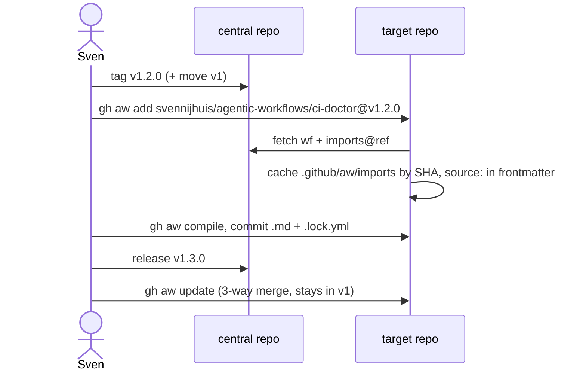

# C05: Imports, import-schema, inlined imports, shared fragments
- Status: todo
- Area: core
- Wave: W1
- Block: 1
- Lane: Builder
- Depends on: C02
- proof: gh aw compile --dir workflows --strict && ./scripts/verify.sh
- door: two-way
## Goal
Standardize remote and local imports: pinned tag or SHA only (POL01), `import-schema` typed parameters, inlined imports cache under `.github/aw/imports/`, and shared formatting/reporting fragments from agentics conventions.
## Context
Consumers install via `gh aw add svennijhuis/agentic-workflows/<wf>@vX.Y.Z`. Lock files record exact import SHAs. squad-review today uses `@marketplace` branch ref; removal tracked under Q7 and F01. agentPacks pins follow [C12 agentpacks import contract](C12-agentpacks-import-contract.md) v1.1.
### Import cache (Block 2 trial)
Consumers either commit `.github/aw/imports/` after compile or set `inlined-imports: true` in frontmatter. Pick one pattern per repo, document in D01, and prove in Block 2 X01 trial before advising production consumers.
## Steps
1. Define import patterns in authoring guide (D05) and shared examples.
2. Migrate workflows off branch refs and marketplace imports to tags or SHAs.
3. Add `import-schema` blocks for parameterized shared pieces (e.g. Azure read-only MCP).
4. Ensure `shared/reporting.md` and formatting helpers match fixed issue/PR format (Bar H).
5. Link C12 allowlist and pin rules in `aw.yml` and POL01 checks.
6. Run Block 2 trial: import cache or inlined-imports on X01 with evidence in C12 and G00a proof.
## Definition of Done
- [ ] No workflow uses `@main` or floating branch refs in production paths
- [ ] `.lock.yml` committed and fresh (POL17)
- [ ] import-schema documented with at least one worked example
- [ ] Packet flow (a) central distribution documented in CONSUMING
## Evidence
(commands, logs, verify log on SHA, run links)
## Flow

## Named asks for Sven
Q7 (tags v1.0.0, moving v1, drop @marketplace import)
## Cost
n/a
## Sources
- https://github.github.com/gh-aw/guides/sharing-workflows/
- https://github.github.com/gh-aw/reference/auth/
- https://github.github.com/gh-aw/reference/cost-management/
- https://github.github.com/gh-aw/reference/imports/
- https://github.github.com/gh-aw/reference/engines/copilot/
- https://github.github.com/svennijhuis/agentic-workflows
