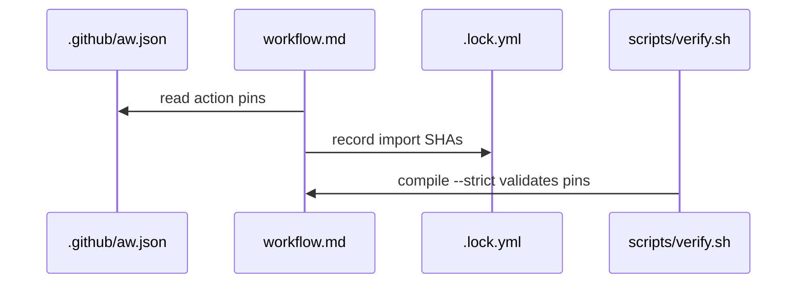

# C06: Copilot engine version and checksum pins
- Status: todo
- Area: core
- Wave: W1
- Block: 1
- Lane: Builder
- Depends on: C03, C05
- proof: gh aw compile --dir workflows --strict && ./scripts/verify.sh
- door: two-way
## Goal
Pin the gh-aw toolchain and Copilot engine action versions in `.github/aw.json` and workflow lock metadata so compiles are reproducible and POL01 is satisfied.
## Context
Bar H requires pinned gh-aw plus import SHA or tag. Engine updates flow through L04 and measured cost audit on first runs after bump.
## Steps
1. Set action pins in `.github/aw.json` per gh-aw compiler config.
2. Record gh-aw CLI version in docs and CHANGELOG on bump.
3. Add gate check alignment with POL01 and POL17.
4. Document upgrade path via L04/L05.
## Definition of Done
- [ ] `.github/aw.json` pins documented and committed
- [ ] `gh aw compile --strict` succeeds with pins
- [ ] No unpinned `@main` action references in compiled output
- [ ] Version bump procedure linked to L04
## Evidence
(commands, logs, verify log on SHA, run links)
## Flow

## Named asks for Sven
none
## Cost
n/a
## Sources
- https://github.github.com/gh-aw/guides/sharing-workflows/
- https://github.github.com/gh-aw/reference/auth/
- https://github.github.com/gh-aw/reference/cost-management/
- https://github.github.com/gh-aw/reference/imports/
- https://github.github.com/gh-aw/reference/engines/copilot/
- https://github.github.com/svennijhuis/agentic-workflows
