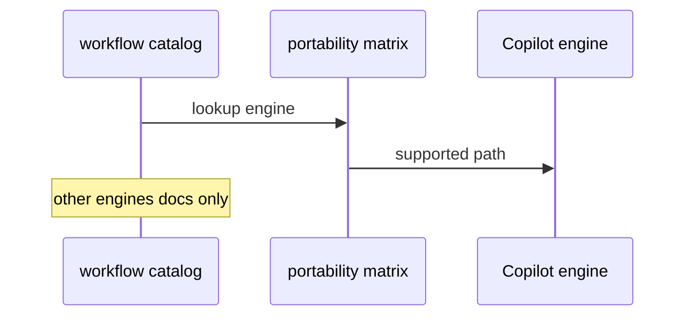

# C07: Engine portability matrix (Copilot primary)
- Status: todo
- Area: core
- Wave: W6
- Block: 6
- Lane: Cursor CLI
- Depends on: C03, C06
- proof: ./scripts/verify.sh
- door: two-way
## Goal
Publish a matrix of gh-aw engines with Copilot as the only supported engine in this catalog; document other engines as reference-only for future portability.
## Context
Settled decision: `engine: copilot` everywhere on the personal account. Matrix helps org-ready consumers if policies change later.
## Steps
1. Draft matrix doc: engine id, auth model, billing, status (supported vs documented only).
2. Link gh-aw engine reference pages.
3. State explicitly that non-Copilot engines are out of scope for W1 through W5 workflows.
## Definition of Done
- [ ] Matrix published under docs/reference or explanation
- [ ] Copilot marked primary and only implemented path
- [ ] Other engines marked reference-only with auth caveats
## Evidence
(commands, logs, verify log on SHA, run links)
## Flow

## Named asks for Sven
none
## Cost
n/a
## Sources
- https://github.github.com/gh-aw/guides/sharing-workflows/
- https://github.github.com/gh-aw/reference/auth/
- https://github.github.com/gh-aw/reference/cost-management/
- https://github.github.com/gh-aw/reference/imports/
- https://github.github.com/gh-aw/reference/engines/copilot/
- https://github.github.com/svennijhuis/agentic-workflows
