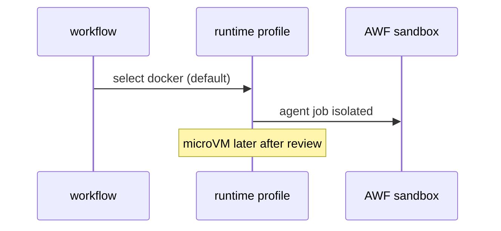

# C08: Runtime profiles (Docker now, microVM later)
- Status: todo
- Area: core
- Wave: W6
- Block: 6
- Lane: Builder
- Depends on: C03, S04
- proof: ./scripts/verify.sh
- door: two-way
## Goal
Document and optionally standardize gh-aw runtime profiles: default Docker sandbox today, future microVM profile when gh-aw supports it for stronger isolation.
## Context
Security architecture (S00, S04) depends on sandbox boundaries. Personal repos start with hosted runners and Docker AWF unless self-hosted (C09) is chosen later.
## Steps
1. Inventory gh-aw runtime options from reference docs.
2. Pick default profile for catalog workflows and document override rules.
3. Plan microVM evaluation when available (no enablement without Sven yes).
## Definition of Done
- [ ] Default runtime profile named in shared security or defaults
- [ ] Override process documented for high-risk workflows
- [ ] microVM noted as future with no silent switch
## Evidence
(commands, logs, verify log on SHA, run links)
## Flow

## Named asks for Sven
none
## Cost
n/a
## Sources
- https://github.github.com/gh-aw/guides/sharing-workflows/
- https://github.github.com/gh-aw/reference/auth/
- https://github.github.com/gh-aw/reference/cost-management/
- https://github.github.com/gh-aw/reference/imports/
- https://github.github.com/gh-aw/reference/engines/copilot/
- https://github.github.com/svennijhuis/agentic-workflows
