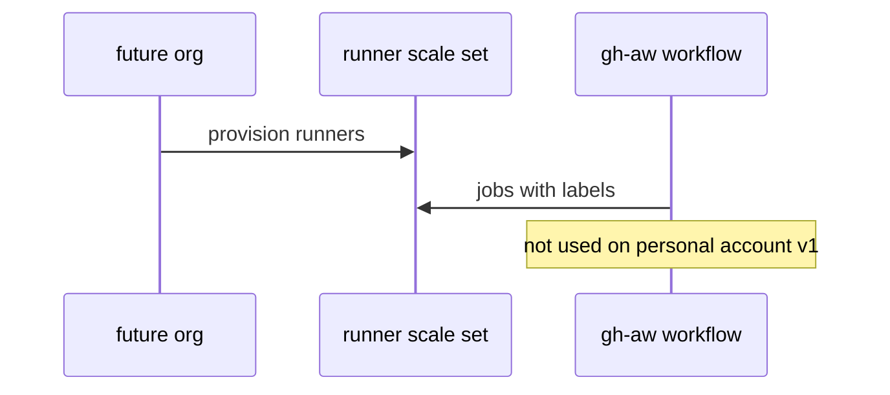

# C09: Self-hosted and ARC runners (org-ready doc)
- Status: todo
- Area: core
- Wave: W6
- Block: 6
- Lane: Builder
- Depends on: C08, S04
- proof: ./scripts/verify.sh
- door: two-way
## Goal
Document how self-hosted and Actions Runner Controller (ARC) runners would integrate with gh-aw for an org switch, without enabling self-hosted on the personal account now.
## Context
G05 org-only appendix covers teams and org secrets; runner pools are often org-scoped. Keep seams documented for CentralRepoOps later.
## Steps
1. Document runner labels, network egress, and secret access for gh-aw jobs.
2. List security tradeoffs vs GitHub-hosted runners.
3. Keep default path as GitHub-hosted for svennijhuis catalog.
## Definition of Done
- [ ] ARC/self-hosted doc exists in governance or reference
- [ ] Personal account default remains GitHub-hosted
- [ ] Org switch checklist references runner section in G05
## Evidence
(commands, logs, verify log on SHA, run links)
## Flow

## Named asks for Sven
none
## Cost
n/a
## Sources
- https://github.github.com/gh-aw/guides/sharing-workflows/
- https://github.github.com/gh-aw/reference/auth/
- https://github.github.com/gh-aw/reference/cost-management/
- https://github.github.com/gh-aw/reference/imports/
- https://github.github.com/gh-aw/reference/engines/copilot/
- https://github.github.com/svennijhuis/agentic-workflows
