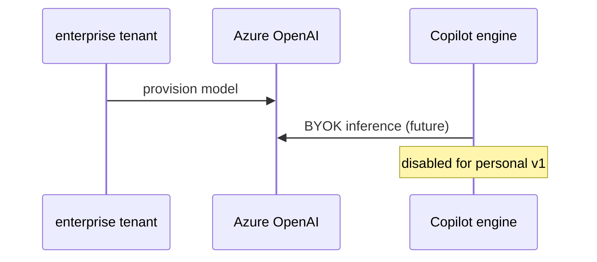

# C10: Copilot BYOK Azure OpenAI (later)
- Status: todo
- Area: core
- Wave: W6
- Block: 6
- Lane: Builder
- Depends on: C07, M04
- proof: ./scripts/verify.sh
- door: two-way
## Goal
Document bring-your-own-key Azure OpenAI path for Copilot engine when needed for enterprise, not activated on personal Pro plan.
## Context
Azure MCP read-only patterns appear in M02/M04. BYOK is a cost and compliance option for orgs, out of scope for initial personal rollout.
## Steps
1. Summarize gh-aw and Copilot BYOK requirements from reference docs.
2. Link to Azure OIDC and key vault patterns without storing keys in repo.
3. Gate any implementation behind explicit Sven approval and budget.
## Definition of Done
- [ ] BYOK doc marked later/not enabled
- [ ] No keys or endpoints in repository
- [ ] Dependencies on Azure reader (M02) noted
## Evidence
(commands, logs, verify log on SHA, run links)
## Flow

## Named asks for Sven
Q4 (if BYOK considered)
## Cost
n/a until enabled
## Sources
- https://github.github.com/gh-aw/guides/sharing-workflows/
- https://github.github.com/gh-aw/reference/auth/
- https://github.github.com/gh-aw/reference/cost-management/
- https://github.github.com/gh-aw/reference/imports/
- https://github.github.com/gh-aw/reference/engines/copilot/
- https://github.github.com/svennijhuis/agentic-workflows
