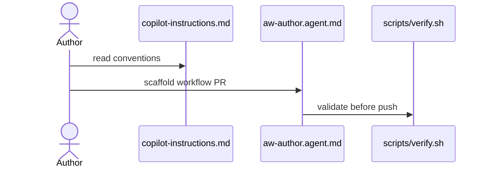

# C11: Instructions: copilot-instructions, AGENTS.md, aw-author agent
- Status: todo
- Area: core
- Wave: W1
- Block: 1
- Lane: Builder
- Depends on: C02
- proof: gh aw compile --dir workflows --strict && ./scripts/verify.sh
- door: two-way
## Goal
Author repository-wide guidance: `.github/copilot-instructions.md`, root `AGENTS.md`, `.github/instructions/*.instructions.md` for workflow authoring, and `.github/agents/aw-author.agent.md` plus skills for consistent gh-aw PRs.
## Context
POL16 house style (no em dash, fixed report format) should be reflected in instructions. Supports Builder lane and Cursor CLI doc authors.
## Steps
1. Add copilot-instructions with catalog conventions and Bar H checklist.
2. Add AGENTS.md entry point for agents and humans.
3. Add per-area instruction files (workflows, policies, docs).
4. Add aw-author custom agent definition referencing skills.
## Definition of Done
- [ ] All four instruction surfaces exist and cross-link
- [ ] House style and POL16 rules echoed in authoring instructions
- [ ] aw-author agent references scripts/verify.sh and policy checks
- [ ] No secrets or real emails in instruction files
## Evidence
(commands, logs, verify log on SHA, run links)
## Flow

## Named asks for Sven
none
## Cost
n/a
## Sources
- https://github.github.com/gh-aw/guides/sharing-workflows/
- https://github.github.com/gh-aw/reference/auth/
- https://github.github.com/gh-aw/reference/cost-management/
- https://github.github.com/gh-aw/reference/imports/
- https://github.github.com/gh-aw/reference/engines/copilot/
- https://github.github.com/svennijhuis/agentic-workflows
