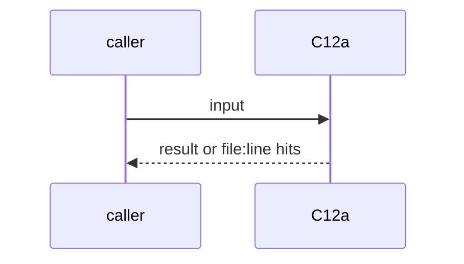
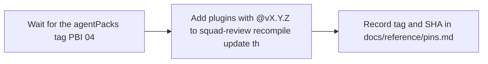

# C12a: agentPacks release tag, then re-add plugins: to squad-review
- Status: todo
- Area: core
- Wave: W2
- Block: 2
- Lane: Builder
- Depends on: C12, agentPacks PBI 04 (first release)
- proof: git ls-remote --tags https://github.com/svennijhuis/agentPacks 'v*' shows the tag; bash policies/checks/POL01.sh passes with `plugins:` pinned to that tag; gh aw compile --dir workflows --strict
- door: two-way
- triage: park (waits for agentPacks PBI 04, the first release tag)
- feedback: POL01 plus strict compile on squad-review
- harness: gh-aw, engine copilot via shared/defaults.md (when built)
- review-input: diff + this PBI + DoD (+ linked spec) + PR description, never builder session logs (PA6)
- kind: script
- Source: PA9 https://github.com/svennijhuis/agentic-workflows/pull/4
## Goal
After agentPacks cuts its first release tag, re-add `plugins:` to `workflows/squad-review.md` pinned to that tag, and record the tag's commit SHA in `docs/reference/pins.md`.
## Context
PR #4 dropped `plugins:` from squad-review: agentPacks has no tags yet and a pin to a main commit loads 0 agents ([C12](../done/C12-agentpacks-import-contract.md) correction). POL01 allows a `plugins:` pin to a vX.Y.Z tag only. agentPacks [PBI 04, First release](https://github.com/svennijhuis/agentPacks/pull/80) (in agentPacks PR #80, not merged yet) cuts that tag; agentPacks PBI 04 names this repo's PBI 101 premise, which C12 records. Not from the 2026-10-25 links: Source is the PR #4 room (PA9 keeps it out of Block 1). Not built in PR #4: docs only, nothing enabled (PA9).
## Steps
1. Wait for the agentPacks tag (PBI 04).
2. Add `plugins:` with `@vX.Y.Z` to squad-review; recompile; update the card if mcp or tools change (POL24).
3. Record tag and SHA in `docs/reference/pins.md`.
## Definition of Done
- [ ] `plugins:` pinned to a vX.Y.Z tag, POL01 green
- [ ] Lock recompiled and committed (POL17)
- [ ] Tag SHA recorded in pins.md
- [ ] squad-review loads the agents (staged run on X01, Bar H)
- [ ] Every Bar H line from [README.md](../README.md#bar-h-every-workflow-pbi) when the workflow ships
## Technical design
- Components and files: `workflows/squad-review.md`, `workflows/squad-review.lock.yml`, `workflows/squad-review.card.yml`, `docs/reference/pins.md`
- Module boundary: one `plugins:` line pinned to a tag
- Interfaces: frontmatter `plugins:`
- Sequence:

- Failure modes: Tag not on the generated commit loads 0 agents: staged run shows it
- Security: Tag pin, never a branch
- Observability: staged run log
- Cost: one staged run on X01
- Rollback: Remove the `plugins:` line and recompile
- Proof: same as proof: above
- Door: two-way (revert is one commit)
## Evidence
(todo)
## Flow

## Named asks for Sven
none
## Cost
one staged run on X01
## Sources
- [agentic-workflows PR #4 room (PO additions PA1 to PA9)](https://github.com/svennijhuis/agentic-workflows/pull/4)
- Strategy id list v3.12 (aw-final-ids.md), url-learnings.md PA9
