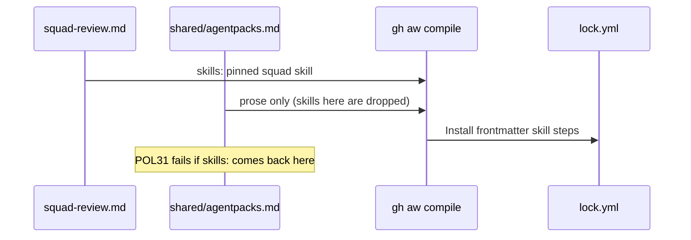

# C12b: skills: in the main workflow, not in a shared fragment
- Status: todo
- Area: core
- Wave: W3
- Block: 2
- Lane: Builder
- Depends on: C12, C05, POL01
- proof: `./scripts/verify.sh` exits 0 with `0 failures`; `sed -n 2p workflows/squad-review.lock.yml` manifest has `"skills":["svennijhuis/agentPacks/plugins/squad/skills/squad@<pin>"]`; `bash policies/checks/POL31.sh test/fixtures/bad/POL31/<case>` exits 1 with 1 hit per case
- door: two-way
- triage: build (real bug on main 14998b6: the squad skill never installs)
- feedback: `./scripts/verify.sh` with `0 failures`, plus the lock manifest `skills` grep above
- harness: none (script) for POL31; gh-aw v0.93.4 compile for the lock
- review-input: diff + this PBI + DoD (+ linked spec) + PR description, never builder session logs (PA6)
- kind: script
- Source: PA8 https://github.com/svennijhuis/agentic-workflows/pull/4 https://github.com/github/gh-aw/blob/main/docs/src/content/docs/reference/frontmatter.md
## Goal
Make the agentPacks squad skill actually install. gh-aw reads `skills:` only from the main workflow and silently drops it from an imported fragment, so `workflows/shared/agentpacks.md` installs nothing today.
## Context
Repo Research proof (`/workspace/research/agentpacks/ghaw-import-map.md` P9, P10, P11, gh-aw v1.0.1). Strategy re-checked on the pinned v0.93.4: the committed `workflows/squad-review.lock.yml` manifest has no `skills` key; with `skills:` moved into `squad-review.md` the compile is clean (0 warnings) and the manifest lists the pinned skill. Two side findings from the same map: a `workflows/shared/` file with `applyTo`, `globs`, `license` or `name` in frontmatter is a compile schema error (compile already catches it, no new rule), and offline `compile --strict` on v1.0.1 needs a committed `.github/aw/actions-lock.json` (not needed on v0.93.4; todo row for the gh-aw bump, not this PBI). F01 builds on squad-review, so this lands before F01.
## Steps
1. Move the `skills:` list from `workflows/shared/agentpacks.md` into `workflows/squad-review.md` frontmatter, same 40-hex pin. Keep the fragment import for its prose note; reword the note to say skills go in the consumer workflow.
2. Recompile the lock with the pinned gh-aw; commit md and lock together.
3. New rule POL31: any `workflows/shared/*.md` frontmatter with a `skills:` key is a hit (`<file>:<line> POL31 skills in shared fragment is silently dropped`), exit 1. Bad fixture `test/fixtures/bad/POL31/shared-skills/`, good fixture `test/fixtures/good/POL31/main-skills/`, both in the POL23 one-hit loop.
4. POL01 allowlist mirror keeps the skill path (no change expected; prove it).
5. Update `docs/reference/agentpacks-contract.md` and `docs/reference/squad-review.md`: skills live in the consumer workflow. Add the "copy this" note: an org copies `squad-review.md`, its lock and `workflows/shared/`, and the skill comes with the md.
## Definition of Done
- [ ] `workflows/squad-review.lock.yml` manifest lists the squad skill at the same pin (grep in Evidence)
- [ ] `workflows/shared/agentpacks.md` has no `skills:` key
- [ ] POL31 bad fixture exits 1 with 1 hit, good exits 0, inside `./scripts/verify.sh` with `0 failures`
- [ ] Lock drift check clean; still `workflow_dispatch` only (POL03), `staged: true`, no new secrets
- [ ] Docs updated, plus the "copy this" note
- [ ] Todo row added: `.github/aw/actions-lock.json` needed when gh-aw moves to v1.x (import map P1)
- [ ] Offline proof only, no run, no token spend
## Technical design
- Components and files: `workflows/squad-review.md`, `workflows/squad-review.lock.yml`, `workflows/shared/agentpacks.md`, `policies/POL31.yml`, `policies/checks/POL31.sh`, `test/fixtures/{bad,good}/POL31/`, `docs/reference/agentpacks-contract.md`, `docs/reference/squad-review.md`
- Module boundary: the consumer workflow frontmatter `skills:` is the interface; gh-aw install steps in the lock are the deep part
- Interfaces: frontmatter `skills:` (list of `owner/repo/path@<40-hex>`); POL31 exit 0 or 1, one line per hit
- Sequence:

- Data and state: none
- Errors and exits: POL31 exit 1 with `<file>:<line> POL31 ...`
- Security: same pin, no new secrets, no new triggers
- Tests: POL31 one-hit loop fixtures; lock manifest grep
- Rollout and rollback: revert the PR
- Open questions: none
## Evidence
## Sources
- /workspace/research/agentpacks/ghaw-import-map.md (P9, P10, P11, P1)
- https://github.com/github/gh-aw/blob/main/docs/src/content/docs/reference/frontmatter.md
