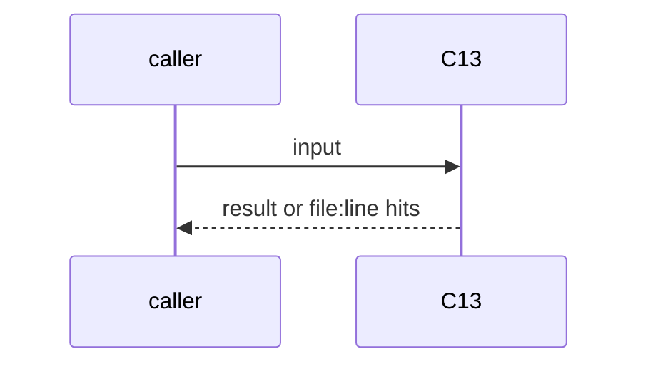
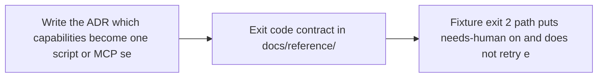

# C13: One capability, one home (was HX04)
- Status: todo
- Area: core
- Wave: W2
- Block: 2
- Lane: Builder
- Depends on: C12, HX02
- proof: ADR `docs/pbi/decisions/` record plus exit code fixture: exit 2 sets needs-human and stops, no retry; exit 1 retried once
- door: one-way
- one-way gate: Sven's exact yes on the shared capability list (named ask below). Rollback: keep the per-workflow copies, revert the ADR
- triage: spec (one-way decision record first)
- feedback: exit code fixture run by scripts/verify.sh
- harness: shared script or MCP server called by gh-aw workflows
- review-input: diff + this PBI + DoD (+ linked spec) + PR description, never builder session logs (PA6)
- kind: script
- Source: D24, D32, D33, PA5 https://www.warp.dev/blog/how-to-build-a-cloud-software-factory-self-improving-code-review https://github.com/pingdotgg/t3code/blob/main/docs/user/outside-agents.md https://github.com/svennijhuis/agentic-workflows/pull/4
## Goal
Code that runs lives in one script or one MCP server that workflows point to; instructions stay skills. A shared capability is read-only by default, has a permission ceiling, and uses exit codes 0 ok, 1 failed (at most 1 retry), 2 needs human (label `needs-human`, stop, never retry).
## Context
Theo: keep code in one place and "expose a simple MCP server" instead of rebuilding it per harness. T3 Code outside agents: "Read only is the default", a thread it starts cannot run with more permissions than the mode chosen, and `--wait` exits 1 when the run fails or stops and 2 when the agent waits for an answer. Warp review: ship deterministic helper scripts as skill resources. PA5. Block 2. Not built in PR #4: docs only, nothing enabled (PA9).
## Steps
1. Write the ADR: which capabilities become one script or MCP server.
2. Exit code contract in `docs/reference/`.
3. Fixture: exit 2 path puts `needs-human` on and does not retry; exit 1 retries once.
## Definition of Done
- [ ] ADR with options, choice and rollback
- [ ] Exit 2 fixture proves the label and no retry
- [ ] Exit 1 fixture proves at most 1 retry
- [ ] Read-only default and permission ceiling written in the contract
## Technical design
- Components and files: `docs/pbi/decisions/`, `docs/reference/`, `test/fixtures/`
- Module boundary: exit codes 0/1/2 and a read-only default are the interface; the capability code is the deep part
- Interfaces: exit 0, 1, 2; label `needs-human`
- Sequence:

- Failure modes: Retry on exit 2 would loop: the fixture fails
- Security: Writes need a named scope; spawned work never exceeds the caller
- Observability: Run summary shows the exit code
- Cost: 0 AIC for scripts
- Rollback: Revert the ADR, keep copies
- Proof: same as proof: above
- Door: one-way (spend or autonomy, Sven's yes)
## Evidence
(todo)
## Flow

## Named asks for Sven
Sven's exact yes before the one-way step: Sven's exact yes on the shared capability list (named ask below)
## Cost
0 AIC for scripts
## Sources
- [Warp blog, self-improving code review](https://www.warp.dev/blog/how-to-build-a-cloud-software-factory-self-improving-code-review)
- [T3 Code, outside agents (MCP)](https://github.com/pingdotgg/t3code/blob/main/docs/user/outside-agents.md)
- [agentic-workflows PR #4 room (PO additions PA1 to PA9)](https://github.com/svennijhuis/agentic-workflows/pull/4)
- Strategy id list v3.12 (aw-final-ids.md), url-learnings.md D24, D32, D33, PA5
