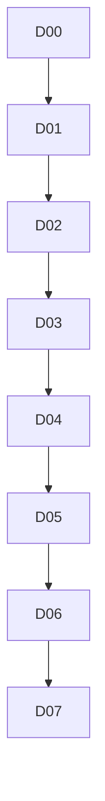

# docs: overview

**Purpose:** Diataxis documentation PBIs (tutorial, how-to, reference).

## PBIs

- [D00: D00-docs-overview](D00-docs-overview.md)
- [D01: D01-quick-start-consumer-guide](D01-quick-start-consumer-guide.md)
- [D02: D02-use-case-catalog](D02-use-case-catalog.md)
- [D03: D03-governance-overview](D03-governance-overview.md)
- [D04: D04-workshop](D04-workshop.md)
- [D05: D05-authoring-guide](D05-authoring-guide.md)
- [D06: D06-cli-runbook](D06-cli-runbook.md)
- [D07: D07-troubleshooting](D07-troubleshooting.md)

## Dependency sketch

