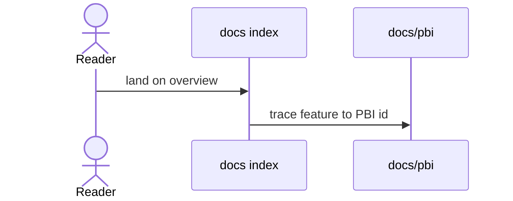

# D00: Documentation overview (Diataxis map)
- Status: todo
- Area: docs
- Wave: PR 0
- Block: 0
- Lane: Cursor CLI
- Depends on: C02
- proof: test -f docs/pbi/docs/D00-docs-overview.md && grep -q '## Definition of Done' docs/pbi/docs/D00-docs-overview.md
- door: two-way
## Goal
Publish Diataxis overview tying tutorials, how-to, reference, explanation, and docs/pbi backlog.
## Context
D00 maps gh-aw introduction pages to our repo paths. PR 0 PBIs are the backlog; W2 ships consumer-facing D01.
## Steps
1. Add `docs/README.md` or index under Diataxis roots.
2. Link CONSUMING.md and GOVERNANCE.md.
3. Cross-link feature-matrix.md.
## Definition of Done
- [ ] Every Diataxis quadrant has an owner path
- [ ] Links to gh-aw official docs where we defer
## Evidence
(links to published Diataxis paths, review notes)
## Flow

## Named asks for Sven
none
## Cost
n/a
## Sources
- https://github.github.com/gh-aw/introduction/overview/
- https://github.github.com/gh-aw/introduction/how-they-work/
