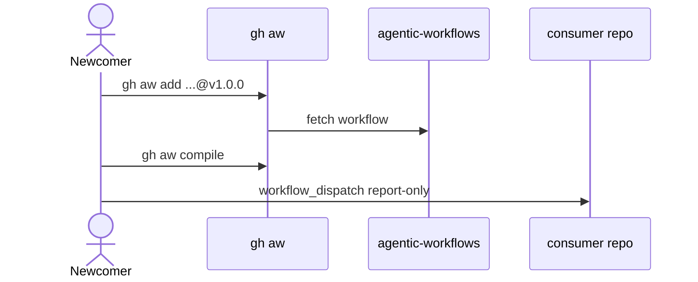

# D01: Quick start and consumer guide
- Status: todo
- Area: docs
- Wave: W2
- Block: 2
- Lane: Cursor CLI
- Depends on: D00, C04, L01, X01, G00a
- proof: test -f docs/pbi/docs/D01-quick-start-consumer-guide.md && grep -q '## Definition of Done' docs/pbi/docs/D01-quick-start-consumer-guide.md
- door: two-way
## Goal
A newcomer installs `gh aw`, adds a pinned workflow, compiles, and runs dispatch safely without mentor help.
## Context
Extends docs/CONSUMING.md into full Diataxis tutorial + how-to. Uses personal `svennijhuis/agentic-workflows` and COPILOT_GITHUB_TOKEN setup (masked, not in files). Consumer install/configure/update strategy: [G00a consumer strategy](../governance/G00a-consumer-strategy.md).
## Steps
1. Prerequisites: Actions, Copilot Pro, gh aw CLI.
2. Walkthrough: add squad-review or ci-doctor @v1.0.0, compile, dispatch report-only.
3. Troubleshooting links to D07.
4. Trial on X01 repo optional step.
## Definition of Done
- [ ] Reviewer with no prior context completes guide in one sitting
- [ ] Every command copy-paste valid
- [ ] Pins tag not branch; no @marketplace import
- [ ] Documents Q0 local verify if CI blocked
## Evidence
(links to published Diataxis paths, review notes)
## Flow

## Named asks for Sven
Q3 (PAT setup), Q7 (tags), X01 (test repo)
## Cost
n/a
## Sources
- https://github.github.com/gh-aw/guides/github-actions-primer/
- https://github.github.com/gh-aw/guides/sharing-workflows/
- docs/CONSUMING.md
