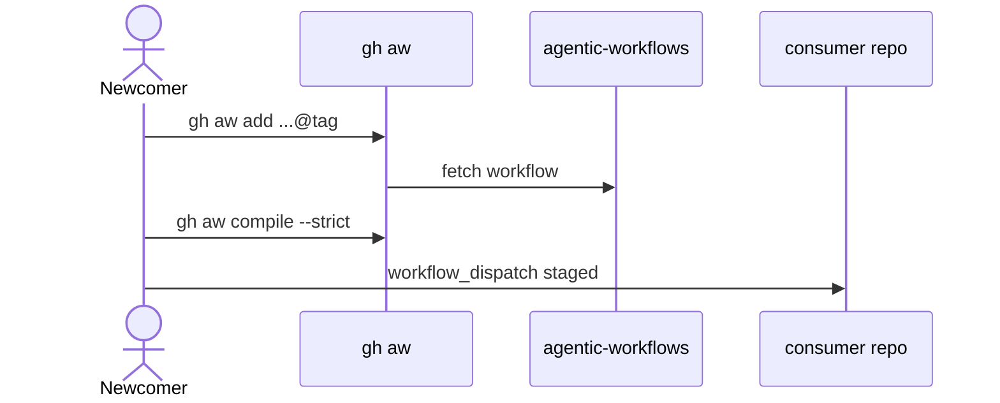

# D01: Quick start and consumer guide
- Status: todo
- Area: docs
- Wave: W2
- Block: 2
- Lane: Cursor CLI
- Depends on: D00, C04, L01, G00a, F01
- proof: `make verify` exits 0; every link on this page resolves to an existing file
- door: two-way
- triage: build
- feedback: `make compile` (`gh aw compile --strict`)
- harness: none (docs page)
- review-input: diff + this PBI + DoD (+ linked spec) + PR description, never builder session logs (PA6)
- kind: skill
- Source: PA8 (pre-link PBI edited in PR #4, origin in its Sources) https://github.com/svennijhuis/agentic-workflows/pull/4
- Module boundary: the quick start page is the interface; [docs/how-to/consume.md](../../how-to/consume.md) holds extended steps
## Goal
A newcomer installs pinned `gh aw`, adds a catalog workflow at an exact tag, passes `gh aw compile --strict`, and runs `workflow_dispatch` in staged mode without mentor help.
## Context
Consumer install, configure, and update strategy: [G00a consumer strategy](../done/G00a-consumer-strategy.md). This page is the Diataxis tutorial; extended how-to lives in [consume.md](../../how-to/consume.md). Gate for catalog and consumer repos: `gh aw compile --strict` clean (same as `make compile` in this repo). Repo verification: `make verify` (compile plus POL25 and POL31). Use a masked `COPILOT_GITHUB_TOKEN` (personal fine-grained PAT); never commit token values in files (secret names only).
## Steps
1. Document prerequisites: GitHub Actions enabled, Copilot Pro, `gh` CLI, pinned `gh aw` v0.93.4 (see [.github/aw.json](../../../.github/aw.json)).
2. Walkthrough: `gh aw add svennijhuis/agentic-workflows/<workflow>@<tag>`, then `gh aw compile --strict --dir workflows`.
3. Explain staged dispatch: run `workflow_dispatch` from Actions; leave `safe-outputs` staged until Sven's yes.
4. Link troubleshooting to [verify-workflow.md](../../how-to/verify-workflow.md).
5. State that catalog maintainers run `make verify` before release; consumers run `gh aw compile --strict` after add or update.
## Definition of Done
- [ ] Reviewer with no prior context completes the guide in one sitting
- [ ] Every command is copy-paste valid (pinned tag, not branch; no `@marketplace` import)
- [ ] Page states the gate is `gh aw compile --strict` clean (0 errors, 0 warnings)
- [ ] Page links only existing files; `make verify` exits 0 on the doc commit
- [ ] Links the F01 "copy this" note at `docs/reference/pr-review.md` once F01 has merged (no markdown link until that file exists)
## Evidence
(published Diataxis path, review notes)
## Flow

## Named asks for Sven
Q3 (PAT setup), Q7 (release tags)
## Cost
n/a
## Sources
- https://github.github.com/gh-aw/guides/github-actions-primer/
- https://github.github.com/gh-aw/guides/sharing-workflows/
- [docs/how-to/consume.md](../../how-to/consume.md)
- [G00a consumer strategy](../done/G00a-consumer-strategy.md)
