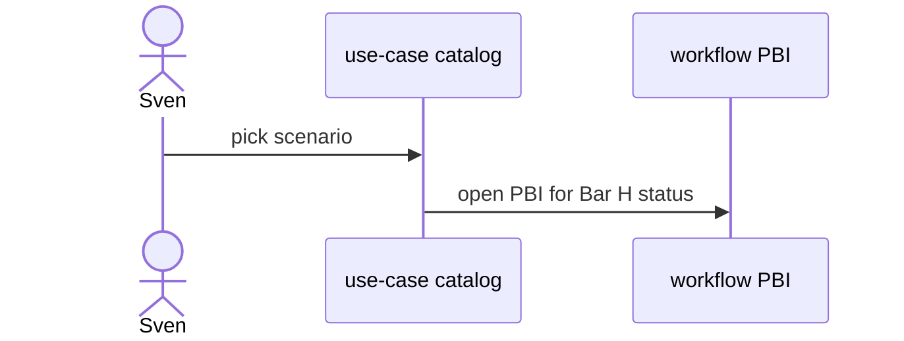

# D02: Use-case catalog
- Status: todo
- Area: docs
- Wave: W5
- Block: 5
- Lane: Cursor CLI
- Depends on: D00, F00, workflow-ratings
- proof: test -f docs/pbi/docs/D02-use-case-catalog.md && grep -q '## Definition of Done' docs/pbi/docs/D02-use-case-catalog.md
- door: two-way
## Goal
Curated catalog of NOW vs later workflows with links to F and P PBIs.
## Context
Sources: gh-aw blog Meet the Workflows series and workflow-ratings.md.
## Steps
1. Table: scenario, workflow id, cost tier, install command.
2. Mark personal-fit vs parked.
3. Link gallery and agentics sources.
## Definition of Done
- [ ] Every NOW workflow from plan has a row
- [ ] Links to docs/pbi/workflow-ratings.md
## Evidence
(links to published Diataxis paths, review notes)
## Flow

## Named asks for Sven
none
## Cost
n/a
## Sources
- https://github.github.com/gh-aw/blog/2026-01-13-meet-the-workflows/
- docs/pbi/workflow-ratings.md
