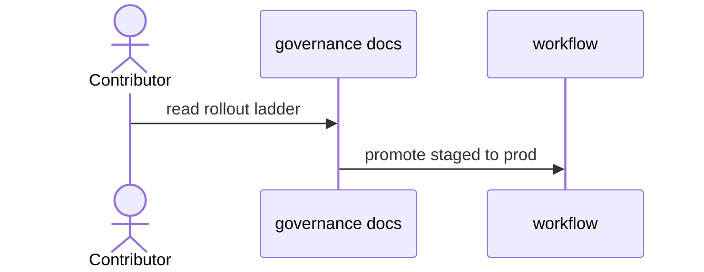

# D03: Governance overview
- Status: todo
- Area: docs
- Wave: W5
- Block: 2
- Lane: Cursor CLI
- Depends on: G01, G02, D00
- proof: test -f docs/pbi/docs/D03-governance-overview.md && grep -q '## Definition of Done' docs/pbi/docs/D03-governance-overview.md
- door: two-way
## Goal
Single entry for rollout ladder, RACI, support, and org-only appendix pointer (G05).
## Context
Align governance/ folder with Diataxis explanation.
## Steps
1. Summarize G01 ladder (report-only, staged, prod).
2. Link RACI.md and ROLLOUT.md.
3. Note personal vs org switch checklist.
## Definition of Done
- [ ] Matches G01-G03 PBIs when those land
- [ ] Q2 visibility called out
## Evidence
(links to published Diataxis paths, review notes)
## Flow

## Named asks for Sven
Q2 (repo visibility)
## Cost
n/a
## Sources
- https://github.github.com/gh-aw/guides/safe-rollout/
- docs/GOVERNANCE.md
