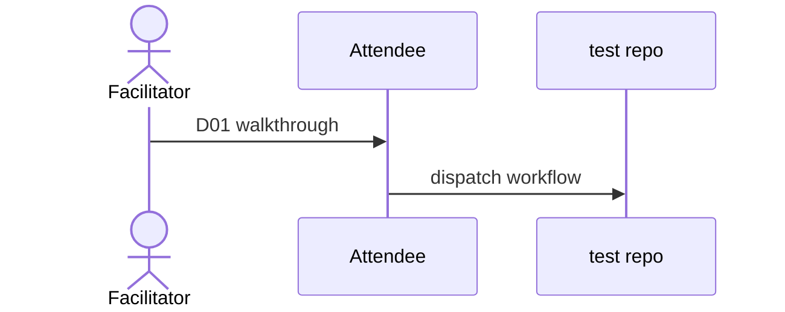

# D04: Workshop and onboarding session
- Status: todo
- Area: docs
- Wave: W5
- Block: 5
- Lane: Cursor CLI
- Depends on: D01, G01
- proof: test -f docs/pbi/docs/D04-workshop.md && grep -q '## Definition of Done' docs/pbi/docs/D04-workshop.md
- door: two-way
## Goal
Adapt gh-aw workshop guide into a 90-minute session for installing catalog workflows.
## Context
Link external workshop; add personal-account notes.
## Steps
1. Agenda, prerequisites, exercises.
2. Use X01 for live demo.
3. Defer org exercises to G05 appendix.
## Definition of Done
- [ ] Facilitator script complete
- [ ] Exercises use dispatch not schedule
## Evidence
(links to published Diataxis paths, review notes)
## Flow

## Named asks for Sven
X01 test repo
## Cost
n/a
## Sources
- https://github.github.com/gh-aw/guides/workshop/
