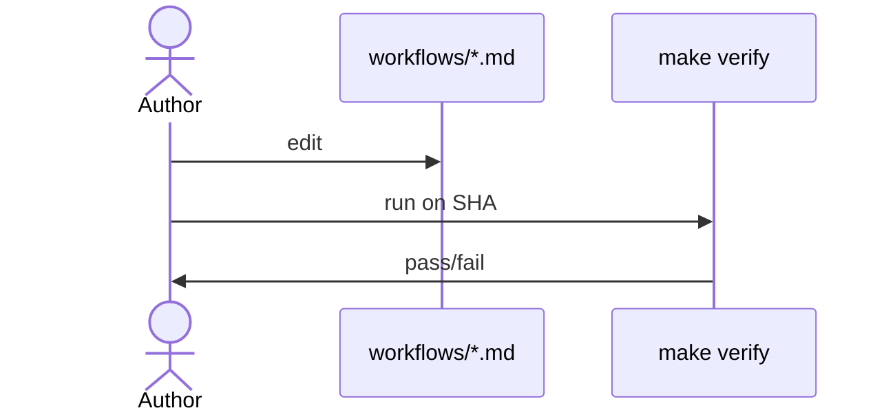

# D05: Workflow authoring guide
- Status: todo
- Area: docs
- Wave: W5
- Block: 5
- Lane: Cursor CLI
- Depends on: C11, D00
- proof: test -f docs/pbi/docs/D05-authoring-guide.md && grep -q '## Definition of Done' docs/pbi/docs/D05-authoring-guide.md
- door: two-way
## Goal
How to author new workflows in this repo: imports, Bar H, gate, compile.
## Context
Targets maintainers; references aw-author agent and instructions.
## Steps
1. Frontmatter checklist.
2. Frontmatter checklist and `make verify` (compile strict, POL25, POL31).
3. PR expectations (lock file, no em dash).
## Definition of Done
- [ ] Links compile strict, POL25, POL31, and Bar H
- [ ] Bar H checklist embedded
## Evidence
(links to published Diataxis paths, review notes)
## Flow

## Named asks for Sven
none
## Cost
n/a
## Sources
- https://github.github.com/gh-aw/reference/imports/
- C11 instructions PBI
