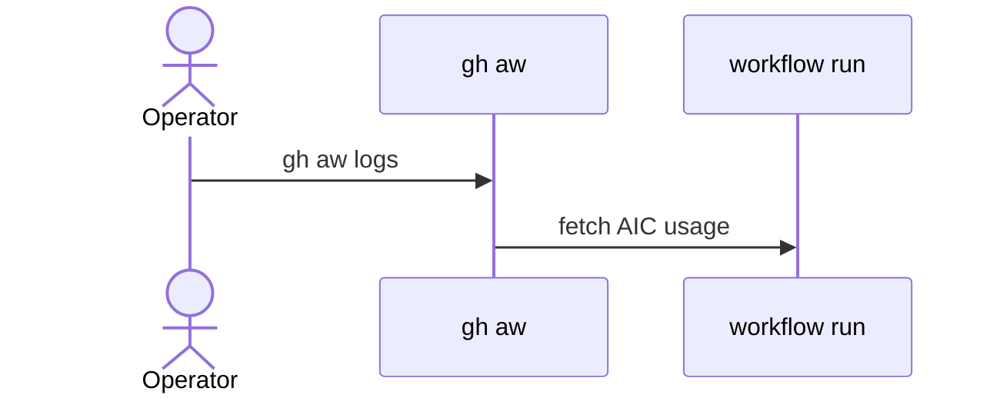

# D06: gh aw CLI runbook
- Status: todo
- Area: docs
- Wave: W5
- Block: 5
- Lane: Cursor CLI
- Depends on: D01, B01
- proof: test -f docs/pbi/docs/D06-cli-runbook.md && grep -q '## Definition of Done' docs/pbi/docs/D06-cli-runbook.md
- door: two-way
## Goal
Operational commands: compile, logs, audit, env, update.
## Context
Support on-call style reference for Sven.
## Steps
1. Command cheat sheet with examples.
2. Document `gh aw env` for masked vars.
3. Link audit and cost flags.
## Definition of Done
- [ ] Covers compile, logs, audit, update
- [ ] No tokens in examples
## Evidence
(links to published Diataxis paths, review notes)
## Flow

## Named asks for Sven
none
## Cost
n/a
## Sources
- https://github.github.com/gh-aw/reference/audit/
- https://github.github.com/gh-aw/
