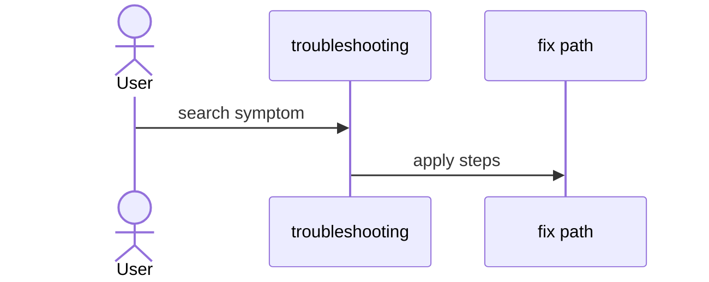

# D07: Troubleshooting guide
- Status: todo
- Area: docs
- Wave: W5
- Block: 5
- Lane: Cursor CLI
- Depends on: D01, D06, C04
- proof: test -f docs/pbi/docs/D07-troubleshooting.md && grep -q '## Definition of Done' docs/pbi/docs/D07-troubleshooting.md
- door: two-way
## Goal
Resolve common failures: PAT, Copilot billing, compile errors, cross-repo perms.
## Context
Include Q0 Actions billing workaround (local verify).
## Steps
1. Symptom to cause to fix tables.
2. COPILOT_GITHUB_TOKEN vs GITHUB_TOKEN.
3. Import pin failures.
## Definition of Done
- [ ] Q0 section for CI blocked
- [ ] Links to gh-aw reference pages
## Evidence
(links to published Diataxis paths, review notes)
## Flow

## Named asks for Sven
Q0, Q3, Q4
## Cost
n/a
## Sources
- https://github.github.com/gh-aw/reference/auth/
- https://github.github.com/gh-aw/reference/billing/
