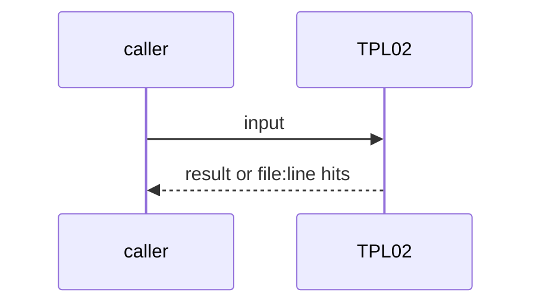
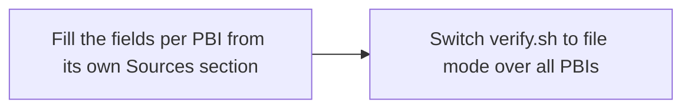

# TPL02: Backfill template fields on the existing PBIs
- Status: todo
- Area: docs
- Wave: W2
- Block: 2
- Lane: Cursor CLI
- Depends on: TPL01
- proof: bash scripts/check-pbi-template.sh $(git ls-files 'docs/pbi/*/*.md') reports 0 hits
- door: two-way
- triage: build (mechanical, one PR)
- feedback: check-pbi-template.sh in file mode over every PBI
- harness: Cursor CLI (docs edits)
- review-input: diff + this PBI + DoD (+ linked spec) + PR description, never builder session logs (PA6)
- kind: skill
- Source: PA8 https://github.com/svennijhuis/agentPacks/pull/80 https://github.com/svennijhuis/agentic-workflows/pull/4
## Goal
Every existing PBI (about 221, plus the done moves) gets the 5 fields, `Source:` and `Module boundary:`. Then the TPL01 check can run on all PBIs, not only on the diff.
## Context
PO scope fix on PA8: TPL01 checks only new or changed PBIs; this is the backfill. Not built in PR #4: docs only, nothing enabled (PA9).
## Steps
1. Fill the fields per PBI from its own Sources section.
2. Switch verify.sh to file mode over all PBIs.
## Definition of Done
- [ ] 0 TPL01 and ARC08 hits over all PBIs
- [ ] verify.sh checks all PBIs
## Technical design
- Components and files: `docs/pbi/**`, `scripts/verify.sh`
- Module boundary: the 6 header lines per PBI
- Interfaces: same as TPL01
- Sequence:

- Failure modes: A Source without a D id for a PBI that predates the links: use PA8 plus the PR URL
- Security: Docs only
- Observability: verify.sh
- Cost: 0 AIC
- Rollback: Revert the PR
- Proof: same as proof: above
- Door: two-way (revert is one commit)
## Evidence
(todo)
## Flow

## Named asks for Sven
none
## Cost
0 AIC
## Sources
- [agentPacks PR #80 (same 5 template fields)](https://github.com/svennijhuis/agentPacks/pull/80)
- [agentic-workflows PR #4 room (PO additions PA1 to PA9)](https://github.com/svennijhuis/agentic-workflows/pull/4)
- Strategy id list v3.12 (aw-final-ids.md), url-learnings.md PA8
