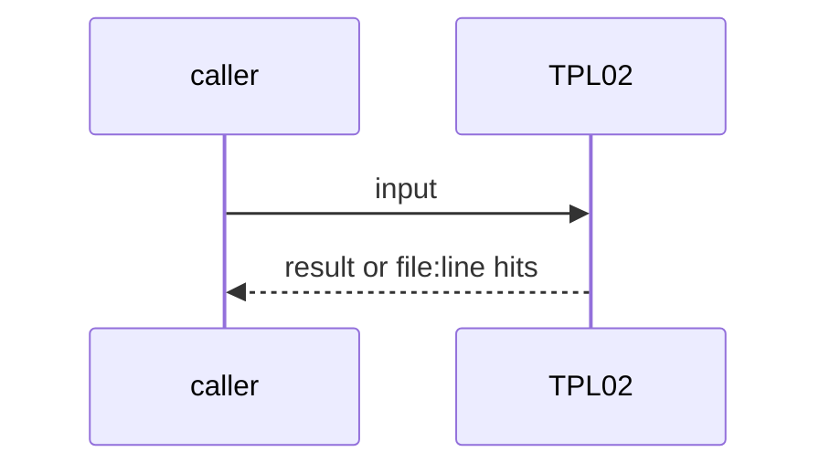
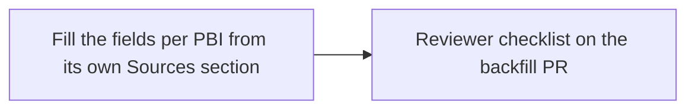

# TPL02: Backfill template fields on the existing PBIs
- Status: todo
- Area: docs
- Wave: W2
- Block: 2
- Lane: Cursor CLI
- Depends on: TPL01
- proof: Reviewer spot-check: every `docs/pbi/*/*.md` has the 5 fields, Source, and Module boundary; `make verify` (exit 0)
- door: two-way
- triage: build (mechanical, one PR)
- feedback: Reviewer file-mode pass over every PBI on the backfill PR
- harness: Cursor CLI (docs edits)
- review-input: diff + this PBI + DoD (+ linked spec) + PR description, never builder session logs (PA6)
- kind: skill
- Source: PA8 https://github.com/svennijhuis/agentPacks/pull/80 https://github.com/svennijhuis/agentic-workflows/pull/4
## Goal
Every existing PBI (about 221, plus the done moves) gets the 5 fields, `Source:` and `Module boundary:`. Reviewers then enforce the template on every PBI PR.
## Context
PO scope fix on PA8: TPL01 checks only new or changed PBIs; this is the backfill. Not built in PR #4: docs only, nothing enabled (PA9).
## Steps
1. Fill the fields per PBI from its own Sources section.
2. Document Reviewer checklist for all PBIs on the backfill PR.
## Definition of Done
- [ ] 0 empty Module boundary or feedback fields over all PBIs
- [ ] Reviewer checklist recorded for the backfill PR
- [ ] G05 (`docs/pbi/done/G05-org-only-appendix.md`): `## Technical design` sits below the Definition of Done and fills the ten template fields (Cursor 5657406190 f3 on PR #12)
## Technical design
- Components and files: `docs/pbi/**`
- Module boundary: the 6 header lines per PBI
- Interfaces: same as TPL01
- Sequence:

- Failure modes: A Source without a D id for a PBI that predates the links: use PA8 plus the PR URL
- Security: Docs only
- Observability: Reviewer sign-off on the PR
- Cost: 0 AIC
- Rollback: Revert the PR
- Proof: same as proof: above
- Door: two-way (revert is one commit)
## Evidence
(todo)
## Flow

## Named asks for Sven
none
## Cost
0 AIC
## Sources
- [agentPacks PR #80 (same 5 template fields)](https://github.com/svennijhuis/agentPacks/pull/80)
- [agentic-workflows PR #4 room (PO additions PA1 to PA9)](https://github.com/svennijhuis/agentic-workflows/pull/4)
- [Cursor review 5657406190 on PR #12 (f3)](https://github.com/svennijhuis/agentic-workflows/pull/12#pullrequestreview-5657406190) and [Reviewer comment 6424506602 (n1)](https://github.com/svennijhuis/agentic-workflows/pull/12#issuecomment-6424506602), carried by the [PO GO](https://github.com/svennijhuis/agentic-workflows/pull/12#issuecomment-6424705952)
- Strategy id list v3.12 (aw-final-ids.md), url-learnings.md PA8
