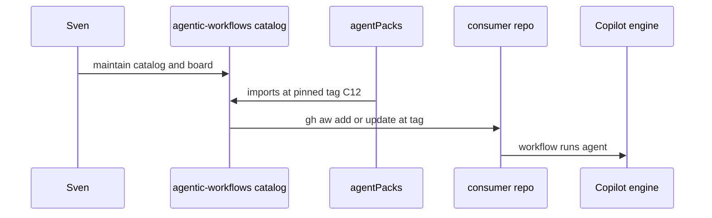
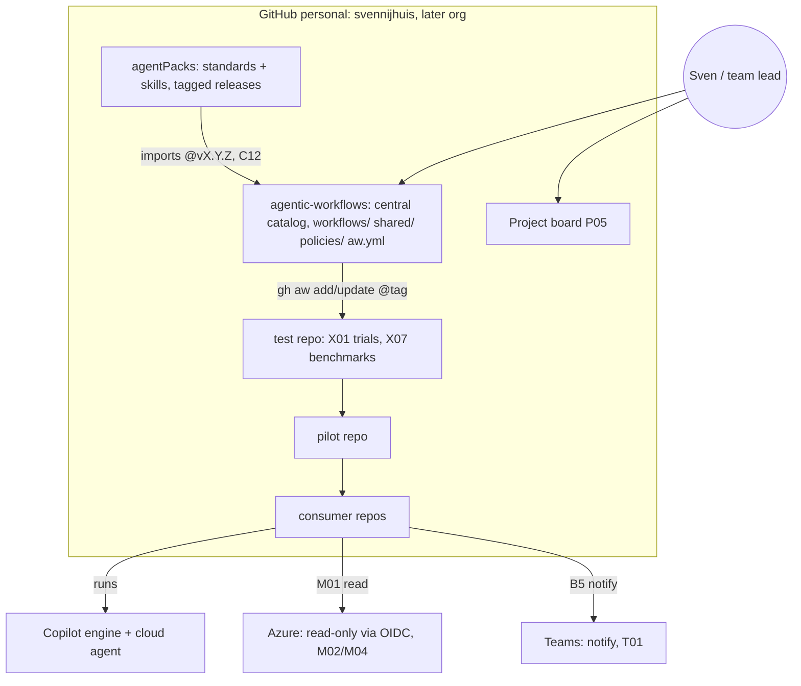

# ARC01: Context and containers
- Status: done
- PR: #4
- Area: architecture
- Wave: PR 0
- Block: 1
- Lane: Cursor CLI
- Depends on: G00
- proof: Open this file on GitHub; mermaid diagram renders; relative links to governance and other ARC pages resolve
- door: two-way
## Goal
Document the C4 context diagram: personal GitHub (later org), central catalog, agentPacks, test and consumer repos, Copilot, Azure read-only, and Teams notify paths.
## Context
Containers inside one consumer run: the Actions runner VM, the agent container (read-only token), the MCP gateway plus firewall, the threat detection job, and the safe-output jobs (write token). See [ARC04](ARC04-safe-output-flow.md). Plan v3.8 G00 = these six pages (agentic-workflows-pbi-plan.md).
## Steps
1. Publish context mermaid matching strategy architecture.md.
2. Link to ARC02-ARC06 and G00 governance pages.
3. Reviewer checks diagram on any edit and house style (no em dash in markdown).
## Definition of Done
- [ ] Context mermaid matches approved strategy diagram
- [ ] All container names and edges documented in prose
- [ ] Links to ARC04 for in-run container detail
- [ ] Renders on GitHub with valid mermaid
## Technical design
- Components and files: `docs/pbi/architecture/ARC01-context.md`; references `agentic-workflows` catalog layout (`workflows/`, `shared/`, `policies/`, `aw.yml`).
- Interfaces: none (documentation); readers use links to workflow and governance PBIs.
- Sequence:

- Failure modes: diagram drifts from live repo names; fixed by ARC05 release review and Reviewer on doc edits.
- Security: diagram shows read-only Azure path (M02/M04) and B5 notify only to Teams; no secret names in prose.
- Observability: n/a (static doc); ARC05 ties releases to diagram review.
- Cost: 0 AIC (docs only).
- Rollback: revert the markdown PR.
- Proof: GitHub preview shows flowchart; `ls docs/pbi/architecture/ARC02-repo-topology.md` resolves from this file link.
- Door: two-way (docs evolve with catalog; no token spend).
## Evidence

Shipped in PR #4 (Block 1). Gate: `make verify` log on the exact head SHA, posted as a PR comment (Q0, Actions billing blocked).
(PR link; GitHub rendered mermaid screenshot optional)
## Flow

## Named asks for Sven
None for this doc page (Q0 test repo name stays in ARC02).
## Cost
0 AIC
## Sources
- Plan v3.8 G00 architecture pages (agentic-workflows-pbi-plan.md)
- [GitHub blog: security architecture of Agentic Workflows](https://github.blog/ai-and-ml/generative-ai/under-the-hood-security-architecture-of-github-agentic-workflows/) (read 2026-10-25)
- Strategy pr0-adds/architecture.md ARC01 (2026-10-25)
