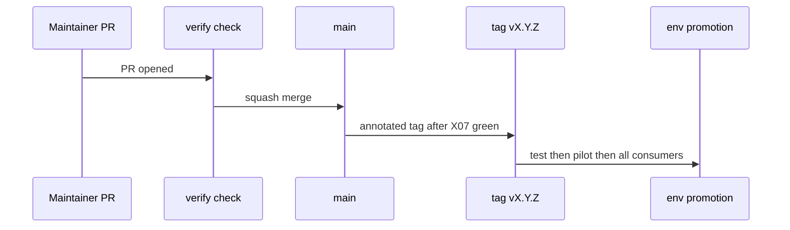
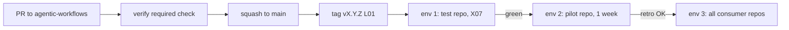

# ARC02: Repo topology
- Status: done
- PR: #4
- Area: architecture
- Wave: PR 0
- Block: 1
- Lane: Cursor CLI
- Depends on: G00
- proof: Open this file on GitHub; mermaid diagram renders; relative links resolve
- door: two-way
## Goal
Name the catalog, standards, and test repos; CODEOWNERS and rulesets on main; environment promotion ladder (test, pilot, all consumers).
## Context
Names: `agentic-workflows` (catalog), `agentPacks` (standards), `aw-test` (test repo, name is Q0), pilot plus consumers keep their own names. Rulesets: PR required, squash only, no force push in automation (normal git push only for humans), linear history, required check `verify` (C01), 0 unresolved threads. Environments: test repo first, then pilot, then all. Promotion = tag moves only after X07 and verify are green.
## Steps
1. Document repo names and CODEOWNERS paths (`workflows/`, `shared/`, `policies/` need Sven; `docs/` needs Sven or PO-approved bot PR).
2. Publish promotion flow mermaid.
3. Cross-link ARC05 release and [X07](../testing/X07-workflow-benchmark.md).
## Definition of Done
- [ ] Repo name table complete including Q0 placeholder
- [ ] CODEOWNERS and ruleset bullets match no-force-push policy and C01
- [ ] Promotion gates name X07 and verify
- [ ] Mermaid renders on GitHub
## Technical design
- Components and files: `docs/pbi/architecture/ARC02-repo-topology.md`; maps to `CODEOWNERS`, GitHub rulesets, `rollout.yml` (later).
- Interfaces: `gh aw add`, tag `vX.Y.Z` (L01), environment protection rules in GitHub UI.
- Sequence:

- Failure modes: tag promoted before X07 baseline; blocked by ARC05 regression rule.
- Security: CODEOWNERS on sensitive paths; no force push on main.
- Observability: required check `verify` visible on every PR.
- Cost: 0 AIC (docs).
- Rollback: revert doc; live ruleset rollback is Sven via GitHub settings.
- Proof: link from [ARC05](ARC05-release-flow.md) resolves; mermaid renders.
- Door: two-way (topology doc tracks repo policy).
## Evidence

Shipped in PR #4 (Block 1). Gate: `make verify` log on the exact head SHA, posted as a PR comment (Q0, Actions billing blocked).
(ruleset export reference when available; verify job name in CI)
## Flow

## Named asks for Sven
Q0: confirm public test repo name when created.
## Cost
0 AIC
## Sources
- Plan v3.8 architecture (agentic-workflows-pbi-plan.md)
- Strategy pr0-adds/architecture.md ARC02 (2026-10-25)
- [C01](C01-verify-script.md) verify required check
