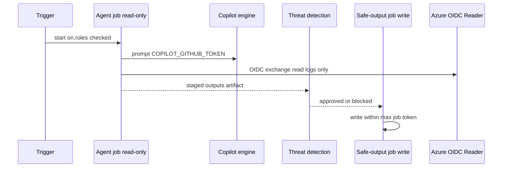
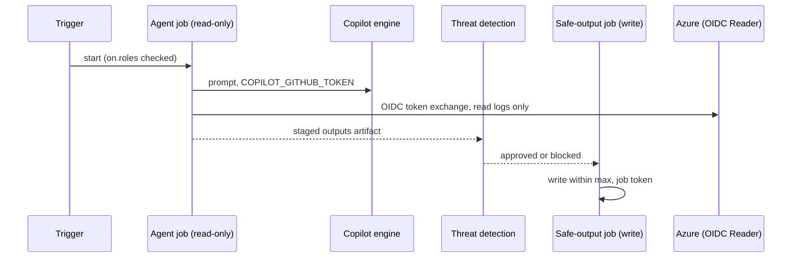

# ARC03: Identity and auth
- Status: done
- PR: #4
- Area: architecture
- Wave: PR 0
- Block: 1
- Lane: Cursor CLI
- Depends on: G00
- proof: Open this file on GitHub; token table and sequence diagram render; links to C04 and multi-repo tokens resolve
- door: two-way
## Goal
Single source for tokens, job permissions, and OIDC: what each holder can and cannot do, including cross-repo M05 and P04 assign tokens.
## Context
No token of ours has `contents:write` or `pull-requests:write` in another repo. The Copilot cloud agent opens PRs in the target repo under its own identity. Cross-repo issue create uses `M05_READ_TOKEN`; cross-repo assign uses `P04_ASSIGN_TOKEN` (separate blast radius). See [ARC04](ARC04-safe-output-flow.md) and [P04](../multi-repo/P04-research-plan-assign-copilot.md).
## Steps
1. Maintain token table (below) as C04 input.
2. Publish agent vs safe-output sequence diagram.
3. Document M05 and P04 named asks for Sven (masked secrets, one-way doors).
## Definition of Done
- [ ] Table lists COPILOT_GITHUB_TOKEN, GITHUB_TOKEN job, safe-output job token, GitHub App (org), Azure OIDC, M05_READ_TOKEN, P04_ASSIGN_TOKEN, BOARD_TOKEN
- [ ] Prose states no cross-repo contents or PR write PAT
- [ ] Mermaid sequence diagram matches gh-aw layers
- [ ] Links to C04 auth doc when merged
## Technical design
- Components and files: `docs/pbi/architecture/ARC03-identity-auth.md`; `docs/reference/auth.md` (C04); repo secrets set by Sven only.
- Interfaces: fine-grained PATs, `GITHUB_TOKEN` read in agent job, OIDC to Azure Reader, safe-output scoped writes in-repo.
- Sequence:

- Failure modes: missing secret fails run at start with name only; wrong PAT scope fails API call without leaking token.
- Security: PATs fine-grained, allowlisted repos; M05 read job cannot assign; P04 cannot read Actions logs across repos.
- Observability: run log names missing secret; never prints secret values (secret names only in repo files).
- Cost: 0 AIC for doc; token proof runs gated per block.
- Rollback: revoke PAT in GitHub settings; revert doc row.
- Proof: secret names listed in runbooks match table; GitHub renders table and diagram.
- Door: two-way for doc; one-way for Sven setting each secret (named asks in M05, P04, C04).
## Evidence

Shipped in PR #4 (Block 1). Gate: `make verify` log on the exact head SHA, posted as a PR comment (Q0, Actions billing blocked).
(`gh secret list` names only screenshot; C04 PR link)
## Flow

### Token table

| Token | Holder | Can | Cannot | Phase |
|---|---|---|---|---|
| COPILOT_GITHUB_TOKEN (fine-grained PAT) | repo secret, set by Sven | call Copilot engine | write repo | now (B2) |
| GITHUB_TOKEN (job) | agent job | read repo | write (read-only in agent job) | now |
| safe-output job token | safe-output jobs only | issues, comments, PRs within `max` | merge (agents never merge) | now |
| M05_READ_TOKEN (fine-grained PAT) | repo secret in agentic-workflows, set by Sven | Actions read, Contents read, Issues write on allowlisted svennijhuis repos only | assign Copilot, contents write, PR write, repos outside allowlist | B4, one-way |
| P04_ASSIGN_TOKEN (fine-grained PAT) | repo secret in agentic-workflows, set by Sven | Issues write, Metadata read on allowlisted repos only | Actions read, Contents read, PR create by our workflow | B5, one-way |
| BOARD_TOKEN (fine-grained PAT; classic only if the first P05 run shows fine-grained cannot reach a user board, Sven decides) | secret set by Sven; deterministic jobs only (P05 sync script, P14 poll pre-step) | Projects read and write on the svennijhuis user board only | any repo contents, issues or PR write; use in an agent job | B3, one-way |
| GitHub App | org later | replaces PAT, scoped per repo | anything outside install | org switch (G05) |
| Azure OIDC federated cred | M02 | Reader on one subscription | any write | B4 |

No token of ours has `contents:write` or `pull-requests:write` in another repo. The Copilot cloud agent opens draft PRs in the target repo under its own identity after P04 assigns the issue.
## Named asks for Sven
Set `M05_READ_TOKEN` and `P04_ASSIGN_TOKEN` as masked repo secrets when M05 and P04 reach their blocks; enable Copilot cloud agent per target repo before auto-fix.
## Cost
0 AIC (doc); PAT proof runs per block
## Sources
- Plan v3.9b P04 assign-only token (agentic-workflows-pbi-plan.md)
- [GitHub blog: security architecture of Agentic Workflows](https://github.blog/ai-and-ml/generative-ai/under-the-hood-security-architecture-of-github-agentic-workflows/) (read 2026-10-25)
- Strategy pr0-adds/architecture.md ARC03 and loops.md tokens (2026-10-25)
