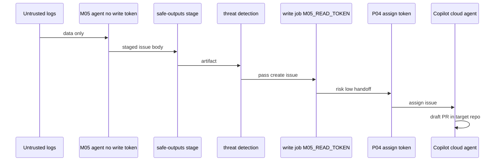
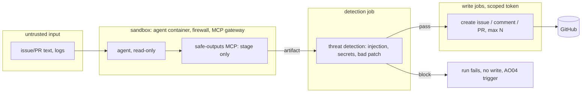
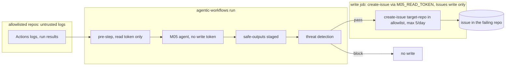

# ARC04: Safe output flow
- Status: done
- PR: #4
- Area: architecture
- Wave: PR 0
- Block: 1
- Lane: Cursor CLI
- Depends on: G00
- proof: Open this file on GitHub; both mermaid diagrams render; link to AO04 resolves
- door: two-way
## Goal
Document trust boundaries: untrusted input, sandboxed agent, threat detection, scoped write jobs, and cross-repo M05 flow with rule-based risk class and P04 handoff.
## Context
Log text is untrusted input (prompt injection, OWASP LLM01): it reaches the agent only as data, and risk class comes from rules in `shared/risk-classes.md` in the catalog repo (model may only raise class, never lower). Cross-repo caps: max 5 issues per day across allowlisted repos, max 1 open auto-fix PR per repo. [AO03](../agent-ops/AO03-kill-switch.md) kill switch noops before any agent turn. On threat detection block, [AO04](../agent-ops/AO04-incident-runbook-postmortem.md) incident path applies.

### Extended cross-repo flow (M05 v2)
1. Central M05 run reads failed Actions logs from allowlisted repos via `M05_READ_TOKEN` (read paths only in the agent job).
2. Rules in `shared/risk-classes.md` set `risk:low` or `risk:high` (model may only move low to high).
3. Write job creates issues with `M05_READ_TOKEN` (`issues:write` only), subgraph labeled accordingly.
4. `risk:low`: same-run P04 assign via `P04_ASSIGN_TOKEN` to Copilot cloud agent in target repo, draft PR under Copilot identity, then F01, verify or consumer CI, Tester, Sven merges.
5. `risk:high`: issue only; Sven decides (`agent-ok` or manual fix).
6. Same fingerprint twice becomes a POL PBI (A5 findings rule).

Plan v3.9 and v3.9b (agentic-workflows-pbi-plan.md); LP00 cross-repo section in pr0-adds/loops.md.
## Steps
1. Publish in-repo safe-output flow mermaid.
2. Publish cross-repo M05 mermaid with corrected write-job subgraph label.
3. Link ARC03 tokens, P04, AO03, AO04, and shared risk rules.
## Definition of Done
- [ ] Trust boundary diagram matches gh-aw safe outputs reference
- [ ] Cross-repo diagram labels write job as M05_READ_TOKEN issues write only
- [ ] Extended flow documents caps, risk rules, P04 handoff, and Copilot-owned PR
- [ ] OWASP LLM01 called out for log text
## Technical design
- Components and files: `docs/pbi/architecture/ARC04-safe-output-flow.md`; runtime in gh-aw safe-output and threat-detection jobs; `shared/risk-classes.md` in catalog.
- Interfaces: safe-outputs MCP stage only; threat detection artifact; write jobs with `max` and scoped token.
- Sequence:

- Failure modes: detection block means no write and AO04 trigger; kill switch noop; daily cap stops extra issues.
- Security: agent job read-only; cross-repo PR never from our PAT; injection in logs cannot escalate writes without passing detection and rules.
- Observability: run id on every issue; fingerprint dedupe in M05 pre-step.
- Cost: M05 spends AIC when not noop; doc 0 AIC.
- Rollback: disable M05 workflow; flip AO03 global var.
- Proof: diagrams render; POL13 threat detection referenced in workflow PBIs.
- Door: two-way doc; M05 and P04 rollout one-way per loops.md.
## Evidence

Shipped in PR #4 (Block 1). Gate: `./scripts/verify.sh` log on the exact head SHA, posted as a PR comment (Q0, Actions billing blocked).
(gh-aw threat detection doc link; sample blocked run id when available)
## Flow

### Cross-repo (M05)

## Named asks for Sven
`M05_READ_TOKEN` and `P04_ASSIGN_TOKEN` per ARC03; Copilot cloud agent enabled per allowlisted repo before auto-fix path.
## Cost
0 AIC for this page; M05 tier per measured B02
## Sources
- [gh-aw safe outputs](https://github.github.com/gh-aw/reference/safe-outputs/) (read 2026-10-25)
- [gh-aw threat detection](https://github.github.com/gh-aw/reference/threat-detection/) (read 2026-10-25)
- Plan v3.9, v3.9b M05 cross-repo (agentic-workflows-pbi-plan.md)
- Strategy pr0-adds/loops.md LP00 v2 cross-repo (2026-10-25)
