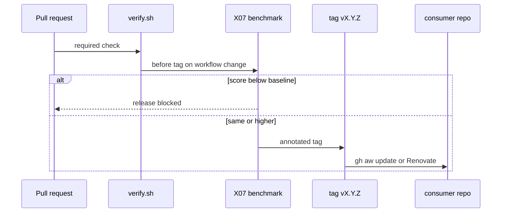
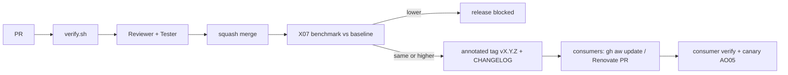

# ARC05: Release flow
- Status: done
- PR: #4
- Area: architecture
- Wave: PR 0
- Block: 1
- Lane: Cursor CLI
- Depends on: G00
- proof: Open this file on GitHub; mermaid diagram renders; links to X07 and AO05 resolve
- door: two-way
## Goal
Describe catalog release from PR through verify, human review, squash, X07 benchmark vs baseline, tag, and consumer update with AO05 canary.
## Context
Regression rule (plan v3.7): a release, prompt bump, model bump, or gh-aw bump runs [X07](../testing/X07-workflow-benchmark.md) first. **A score lower than baseline blocks the release.** Same rule feeds [AO05](../agent-ops/AO05-change-management.md) change management. Consumer path: annotated tag, CHANGELOG, `gh aw update` or Renovate PR, consumer verify plus canary.
## Steps
1. Publish release flow mermaid with X07 gate.
2. Tie to L01 tag policy and ARC02 environment promotion.
3. Document blocked release when benchmark regresses.
## Definition of Done
- [ ] Flow shows verify.sh, Reviewer, Tester, squash, X07, tag, consumer update
- [ ] Explicit branch when X07 score is lower than baseline (release blocked)
- [ ] Links to X07 and AO05
- [ ] Mermaid valid on GitHub
## Technical design
- Components and files: `docs/pbi/architecture/ARC05-release-flow.md`; `CHANGELOG`; `docs/benchmarks/<workflow>.md` baselines; L01 tag workflow.
- Interfaces: `./scripts/verify.sh`, X07 harness, `gh aw update` on consumers.
- Sequence:

- Failure modes: baseline stale; fix by updating baseline only after Sven yes and justified improvement tradeoff.
- Security: no release on red verify; threat detection stays on in released workflows.
- Observability: benchmark row per release in docs/benchmarks; AO02 scorecard on push main.
- Cost: X07 spend per release when workflows change (gated).
- Rollback: pin consumers to previous tag; revert main commit.
- Proof: diagram documents block path; X07 PBI links here.
- Door: two-way doc; tag promotion one-way per AO05.
## Evidence

Shipped in PR #4 (Block 1). Gate: `./scripts/verify.sh` log on the exact head SHA, posted as a PR comment (Q0, Actions billing blocked).
(sample blocked release note; benchmark markdown path)
## Flow

## Named asks for Sven
Yes before spending AIC on release X07 runs; yes to move baseline when intentionally changing behavior.
## Cost
0 AIC for doc; X07 per release event
## Sources
- Plan v3.7 regression rule and ARC05 (agentic-workflows-pbi-plan.md)
- Strategy pr0-adds/architecture.md ARC05 (2026-10-25)
- [X07-workflow-benchmark](../testing/X07-workflow-benchmark.md)
