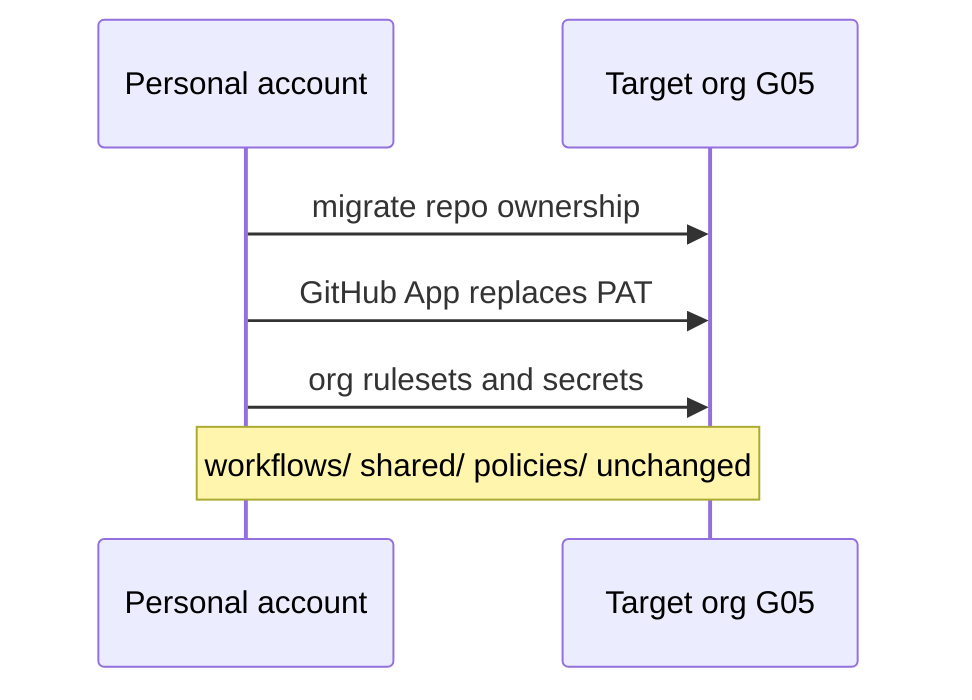
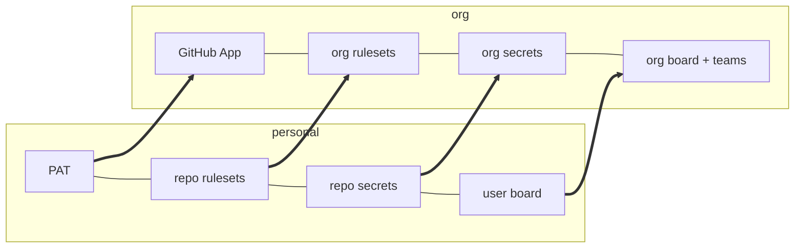

# ARC06: Org switch
- Status: done
- PR: #4
- Area: architecture
- Wave: PR 0
- Block: 1
- Lane: Cursor CLI
- Depends on: G00
- proof: Open this file on GitHub; mermaid and table render; links to G05 and G00 resolve
- door: two-way
## Goal
List what changes when moving from personal `svennijhuis` to the target org (G05): only the boxes in the table and diagram, not workflow files, policies, or pins.
## Context
Only these boxes change at the org switch (G05). Workflow files, policies, and pins stay the same, which is the point of G00. Detail checklist: [G05-org-only-appendix](../governance/G05-org-only-appendix.md). Target structure: [G00-org-target-structure](G00-org-target-structure.md).
## Steps
1. Publish personal vs org comparison table.
2. Publish migration mermaid (PAT to App, rulesets, secrets, board, teams).
3. State explicitly that workflow content is unchanged.
## Definition of Done
- [ ] Table covers owner, engine auth, rulesets, secrets, board, CODEOWNERS, teams
- [ ] Prose says only listed boxes change
- [ ] Links to G05 and G00 governance pages
- [ ] Diagram renders on GitHub
## Technical design
- Components and files: `docs/pbi/architecture/ARC06-org-switch.md`; [G05](../governance/G05-org-only-appendix.md) runbook; GitHub App install (later).
- Interfaces: org secrets, org rulesets, org Projects, team `@org/aw-maintainers`.
- Sequence:

- Failure modes: partial migration breaks consumers; G05 checklist orders steps.
- Security: App replaces broad PAT; org Copilot billing.
- Observability: same verify check on consumers after switch.
- Cost: 0 AIC (doc and manual migration).
- Rollback: revert ownership only with Sven plan (one-way); doc revert is two-way.
- Proof: G05 link resolves; table matches strategy architecture.md.
- Door: two-way for doc; org cutover steps in G05 are one-way with Sven.
## Evidence

Shipped in PR #4 (Block 1). Gate: `./scripts/verify.sh` log on the exact head SHA, posted as a PR comment (Q0, Actions billing blocked).
(G05 checklist PR; org name Q2 when decided)
## Flow

| Box | Personal now | Org later |
|---|---|---|
| Repo owner | svennijhuis | org (name Q2) |
| Engine auth | PAT | GitHub App + org Copilot billing |
| Rulesets | repo rulesets | org rulesets on all AW consumers |
| Secrets | repo secrets | org secrets, selected repos |
| Board | user Project | org Project |
| CODEOWNERS | Sven | team `@org/aw-maintainers` |
| Teams | none | `aw-maintainers`, `aw-consumers` |
## Named asks for Sven
Q2 org name; execute G05 steps in order when ready.
## Cost
0 AIC
## Sources
- [G05-org-only-appendix](../governance/G05-org-only-appendix.md)
- [G00-org-target-structure](G00-org-target-structure.md)
- Strategy pr0-adds/architecture.md ARC06 (2026-10-25)
- Plan v3.8 G00 (agentic-workflows-pbi-plan.md)
