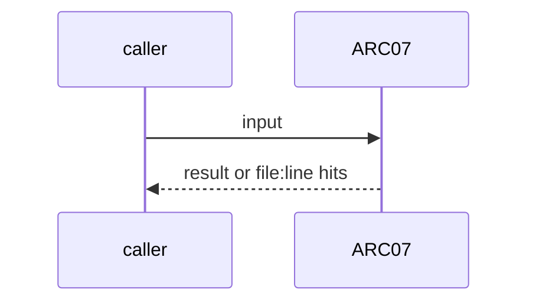
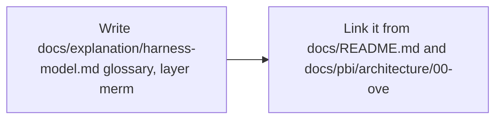

# ARC07: Harness model: glossary and layer map (was HX01)
- Status: done
- PR: #4
- Area: architecture
- Wave: W1
- Block: 1
- Lane: Builder
- Depends on: G00, ARC01
- proof: test -f docs/explanation/harness-model.md && grep -q 'squad-review' docs/explanation/harness-model.md && mmdc -i docs/explanation/harness-model.md -o /tmp/arc07.svg
- door: two-way
- triage: build (doc only, scope clear)
- feedback: grep proof above plus mmdc render of the page
- harness: none (docs page read by humans and agents)
- review-input: diff + this PBI + DoD (+ linked spec) + PR description, never builder session logs (PA6)
- kind: skill
- Source: D37 https://x.com/theo/status/2113424203345265053
## Goal
One explanation page that names interface, harness, model, tools and MCP for this catalog, with a layer mermaid and a row per catalog workflow. HX01 is folded into ARC07.
## Context
Theo: a harness is tools, a call syntax, a parser that runs the code, a way to return the result, and a list of tools with descriptions. The interface is separate from the harness, and an agent is a harness configuration. In gh-aw terms the workflow `.md` is the configuration, the engine plus sandbox is the harness, and the lock is what runs.
## Steps
1. Write `docs/explanation/harness-model.md`: glossary, layer mermaid, catalog table, agent card pointer (HX02).
2. Link it from `docs/README.md` and `docs/pbi/architecture/00-overview.md`.
## Definition of Done
- [x] Page exists with glossary for interface, harness, model, agent configuration, tools, MCP
- [x] Layer mermaid renders with mmdc
- [x] Catalog table has a row for `squad-review` with every layer filled
- [x] Links from docs README and architecture overview resolve (LINK rule)
## Technical design
- Components and files: `docs/explanation/harness-model.md`, `docs/README.md`, `docs/pbi/architecture/00-overview.md`
- Module boundary: the glossary and table are the interface; the gh-aw compiler and lock stay the deep part behind it
- Interfaces: Diataxis explanation page; no workflow frontmatter change
- Sequence:

- Failure modes: A new catalog workflow ships without a row: HX02 card check (POL24) still holds the facts, the page is updated in the same PR
- Security: Docs only, no tokens
- Observability: LINK rule in scripts/verify.sh
- Cost: 0 AIC
- Rollback: Revert the page and its two links
- Proof: same as proof: above
- Door: two-way (revert is one commit)
## Evidence
Verify log on the exact head SHA of PR #4 (Q0, Actions billing blocked).
## Flow

## Named asks for Sven
none
## Cost
0 AIC
## Sources
- [Theo, What is a harness?](https://x.com/theo/status/2113424203345265053)
- Strategy id list v3.12 (aw-final-ids.md), url-learnings.md D37
