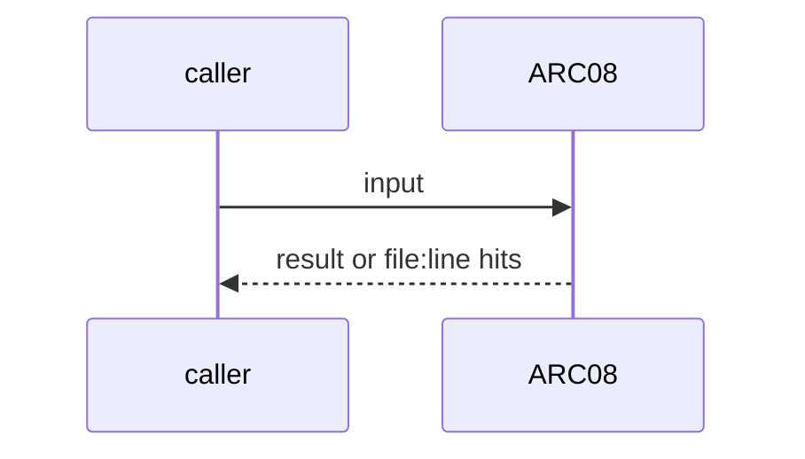
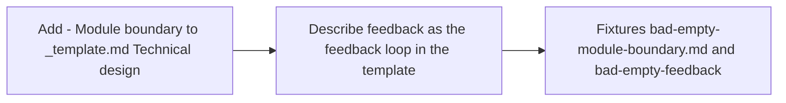

# ARC08: Template field: module boundary and feedback loop
- Status: done
- PR: #4
- Area: architecture
- Wave: W1
- Block: 1
- Lane: Builder
- Depends on: TPL01
- proof: bash scripts/check-pbi-template.sh test/fixtures/template/bad-empty-module-boundary.md (exit 1); same on bad-empty-feedback.md (exit 1); good.md (exit 0)
- door: two-way
- triage: build (template change with its check)
- feedback: bash scripts/check-pbi-template.sh on the template fixtures
- harness: none (script run by scripts/verify.sh)
- review-input: diff + this PBI + DoD (+ linked spec) + PR description, never builder session logs (PA6)
- kind: script
- Source: D38 https://x.com/mattpocockuk/status/2112184048248336654
## Goal
`docs/pbi/_template.md` gets `- Module boundary:` in Technical design (deep modules) and the `- feedback:` field names the feedback loop (the test, check or type check that tells the agent it is done). An empty field is red.
## Context
Matt Pocock's map puts "Deep modules" and "Tests and types as feedback loops" in The Environment. PO gap 2. The feedback loop field is the TPL01 `feedback:` field, so there is one field, not two.
## Steps
1. Add `- Module boundary:` to `_template.md` Technical design.
2. Describe `feedback:` as the feedback loop in the template.
3. Fixtures `bad-empty-module-boundary.md` and `bad-empty-feedback.md`.
## Definition of Done
- [x] Template has both fields
- [x] check-pbi-template.sh red on an empty module boundary and on an empty feedback field
- [x] Every new or changed PBI in this PR has both filled
## Technical design
- Components and files: `docs/pbi/_template.md`, `scripts/check-pbi-template.sh`, `test/fixtures/template/`
- Module boundary: two template lines are the interface; the diff-scoped check is behind them
- Interfaces: Lines `- Module boundary: <text>` and `- feedback: <command>`; rule ids ARC08 and TPL01
- Sequence:

- Failure modes: A `<placeholder>` counts as empty
- Security: No tokens
- Observability: verify.sh section PBI template
- Cost: 0 AIC
- Rollback: Revert the two template lines and the ARC08 rule
- Proof: same as proof: above
- Door: two-way (revert is one commit)
## Evidence
Verify log on the exact head SHA of PR #4 (Q0, Actions billing blocked).
## Flow

## Named asks for Sven
none
## Cost
0 AIC
## Sources
- [Matt Pocock, Software Factory map](https://x.com/mattpocockuk/status/2112184048248336654)
- Strategy id list v3.12 (aw-final-ids.md), url-learnings.md D38
