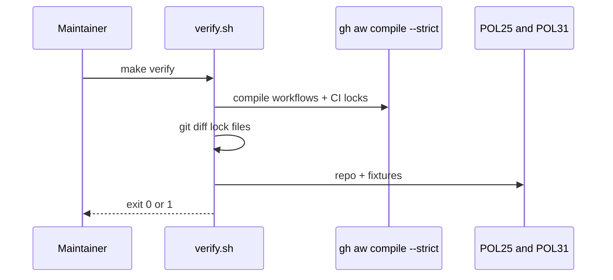
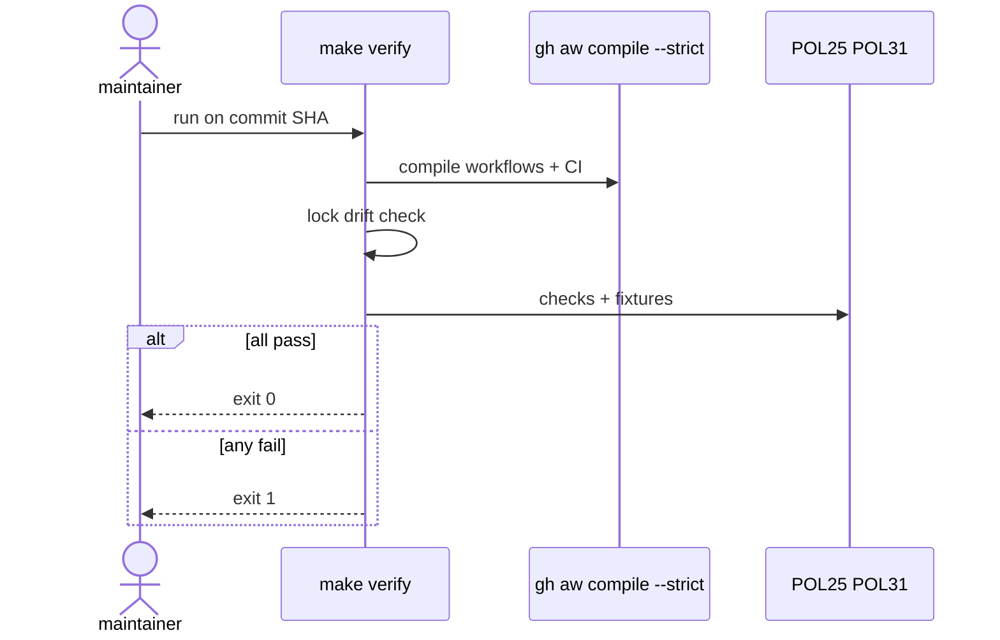

# C01: Verify script (`scripts/verify.sh`)
- Status: done
- PR: #4
- Area: core
- Wave: W1
- Block: 1
- Lane: Builder
- Depends on: none
- proof: `make verify` (exit 0 on green SHA)
- door: two-way
## Goal
Ship one verify script (`scripts/verify.sh`, invoked via `make verify`) that local developers and CI both run. It blocks bad workflow changes before merge. Until GitHub Actions billing is fixed (Q0), a green run on the exact commit SHA is the release authority instead of CI.
## Context
Plan W1 starts with [X06](X06-verification-skill.md) (verification skill spec) then C01. The gate follows githubnext/agentics: `gh aw compile --strict` is the primary check, plus POL25 and POL31 repo checks with good and bad fixtures. Personal account `svennijhuis` only; org rulesets may mirror no-force-push later (G05).
## Steps
1. Add `scripts/verify.sh` with a stable interface: `make verify` from repo root, non-zero exit on any failure.
2. Compile: `make compile` runs `gh aw compile --strict --dir workflows` and on `.github/workflows` when it holds agentic `.md` files; fail if lock files drift after compile.
3. Run `policies/checks/POL25.sh` and `policies/checks/POL31.sh` on the repo and on paired fixtures under `test/fixtures/good/` and `test/fixtures/bad/`.
4. Pin CI helpers per gist C: `actions/checkout` by full SHA (not a floating tag) and `gh-aw` extension v0.93.4 in `.github/aw.json`. Point `.github/workflows/verify.yml` at `make verify` plus gitleaks.
5. Document Q0 in CONTRIBUTING (Builder): when Actions billing is blocked, attach verify log on SHA in PR evidence.
## Definition of Done
- [x] `make verify` runs compile strict, lock drift check, POL25, POL31, and fixture cases
- [x] Verify passes on green SHA with POL25 and POL31 good fixtures
- [x] Verify fails on each POL25 and POL31 bad fixture
- [x] CI workflow calls the same script as local (when Q0 unblocks Actions billing)
- [x] Evidence: verify log attached for at least one green SHA
## Technical design
- Components and files: `scripts/verify.sh`, `Makefile`, `policies/checks/POL25.sh`, `policies/checks/POL31.sh`, CI job `verify`
- Interfaces: `make verify`. Exit 0 on pass, 1 on fail
- Sequence:

- Failure modes: Missing gh-aw pin fails loud; lock drift fails with recompile and commit
- Security: gitleaks in CI; no network beyond tool installs in verify.sh
- Observability: Same output local and CI
- Cost: 0 AIC (script)
- Rollback: Revert the script commit
- Proof: `make verify` green on main, red on bad fixtures
- Door: two-way (local script)
## Evidence

Shipped in PR #4 (Block 1). Gate: `make verify` log on the exact head SHA, posted as a PR comment (Q0, Actions billing blocked).
## Flow

## Named asks for Sven
Q0 (GitHub Actions billing blocked; local `make verify` on SHA until fixed)
## Cost
n/a
## Sources
- https://github.github.com/gh-aw/guides/sharing-workflows/
- https://github.com/svennijhuis/agentic-workflows/pull/2
- Gist handover points A, B, C (`gist-handover-agentic-workflows.md` in workspace, plain text only)
- Plan v3.2 C01 verify.sh
